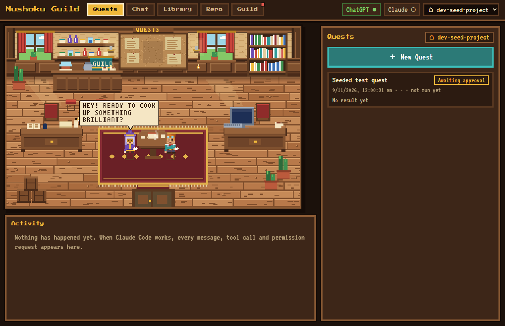
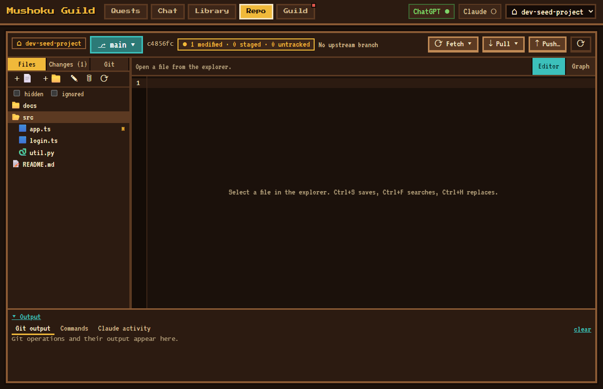
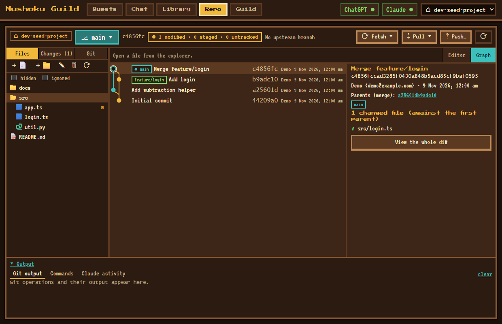
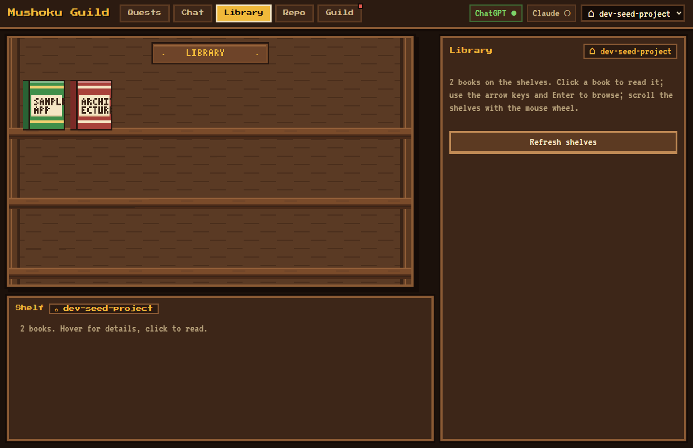
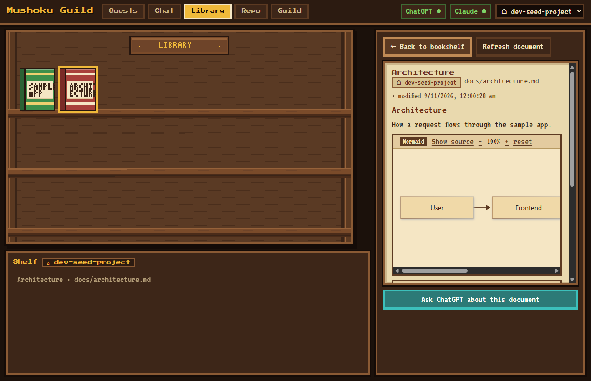
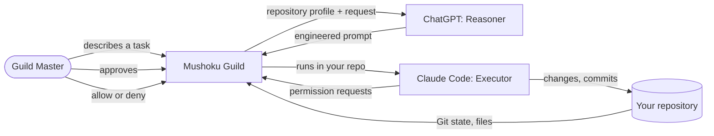

<div align="center">

# Mushoku Guild

**Your AI-powered development guild, inside a cozy pixel-art café.**

*ChatGPT is the Reasoner. Claude Code is the Executor. You are the Guild Master.*

Windows desktop app · Tauri 2 · Rust · React + TypeScript · PixiJS · SQLite



</div>

Mushoku Guild brings AI conversations, repository research, coding quests, documentation, Git and project management into **one lightweight Windows desktop application**. You describe a task, ChatGPT turns it into a precise engineering prompt, Claude Code executes it in your repository, and you approve, watch and review every step. No more copy-pasting between a chat window and a terminal.

> **Status: version 0.1.0, first release.** It works end to end and has been tested on Windows 11, but it is early software. Read [Known limitations](#known-limitations) before relying on it. The ChatGPT sign-in is an **experimental integration** (see [Supported integrations](#supported-integrations)).

## Screenshots

| Repo: editor and Git workbench | Repo: real Git graph |
|---|---|
|  |  |

| Library bookshelf | Library: Mermaid diagrams |
|---|---|
|  |  |

*Screenshots show a small disposable sample repository. Guild Chat is not pictured because it needs a signed-in ChatGPT account and real conversation history; I did not want to publish either.*

## Features

- **Pixel-art café.** The Reasoner and Executor appear as characters; quests are tickets on the board; speech bubbles show what they are doing. The scene idles at near-zero CPU and pauses when hidden.
- **Repository = workspace.** Each Git repository has its own conversations, quests, research, permissions, library and editor tabs. Switching repository switches all of them.
- **Quests.** Describe a task, get an engineered prompt from ChatGPT, approve it, run it with Claude Code, and keep a searchable history with outcomes and activity.
- **Guild Chat.** Chat with ChatGPT about a project. When it needs evidence it asks Claude, read-only, to inspect the code. Conversations are saved per repository.
- **Permissions you control.** Per-repository trust, three execution policies, an optional Auto Pilot for ordinary commands, and every dangerous request sent to you.
- **Repo workspace.** Native file explorer, a CodeMirror 6 editor (16 languages, find/replace, save, external-change detection) and a complete [Git workbench](docs/GIT_WORKBENCH.md) with a lane-based commit graph.
- **Library.** A bookshelf of the repository's Markdown documents with a reader that renders tables, highlighted code and **Mermaid diagrams**.
- **Launched services.** Servers that a quest starts are tracked; open, focus or stop them.
- **Claude in Chrome (optional).** Lets a quest use the official Claude in Chrome extension.

Full list with status: [docs/FEATURES.md](docs/FEATURES.md).

## How it works



The Rust core owns every privileged operation (files, Git, processes, credentials, SQLite). The React frontend can only call named commands and render events. Details: [docs/ARCHITECTURE.md](docs/ARCHITECTURE.md) and [docs/AGENT_WORKFLOWS.md](docs/AGENT_WORKFLOWS.md).

## Supported integrations

| Integration | What it does | Status |
|---|---|---|
| **Claude Code CLI** | Executor for quests and read-only research | Working. Uses the `claude` you installed and signed in yourself; Mushoku Guild does not bundle it or touch its credentials. |
| **ChatGPT** | Reasoner for prompts and Guild Chat | **Experimental.** Signs in with your ChatGPT account through an OAuth flow (PKCE, loopback callback). The endpoint is not a documented public API for third-party apps and may change or stop working. |
| **Git** | Whole Git workbench | Working. Uses the `git` executable on your PATH. |
| **Claude in Chrome** | Browser actions inside quests | Optional; requires the official extension and Chrome. |

You need your own ChatGPT and Claude subscriptions. Whether your plan's terms permit this kind of use is for you to check; this project makes no claim about it.

## Installation

Requirements: **Windows 10/11 (x64)**, the **WebView2 runtime** (the installer downloads it if missing), **Git**, and the **Claude Code CLI** installed and signed in.

1. Download `Mushoku-Guild_<version>_windows-x64_setup.exe` from the [Releases page](https://github.com/techsmarttpk/mushoku-guild/releases) (if a release has been published) or build it yourself ([docs/DEVELOPMENT.md](docs/DEVELOPMENT.md)).
2. Run it. The installer is **not code-signed**, so Windows SmartScreen may show "Windows protected your PC". Choose *More info → Run anyway* only if you trust where you got the file; compare its SHA-256 with the published checksum.
3. Start **Mushoku Guild** from the Start menu.

More: [docs/INSTALLATION.md](docs/INSTALLATION.md) · Problems: [docs/TROUBLESHOOTING.md](docs/TROUBLESHOOTING.md).

## Getting started

1. Open the **Guild** tab, click **Connect ChatGPT** and check that Claude Code is detected.
2. Click **Choose folder…** and pick a Git repository. Decide whether to trust it (this gates anything that can run code).
3. **Quests → New Quest**: describe what you want, review the prompt ChatGPT writes, approve it, then **Start Claude Code**. Allow or deny the permission requests that appear.
4. Use **Chat** to discuss the project, **Repo** to browse, edit and commit, and **Library** to read its documentation.

## Repository structure

```text
src/            React UI (src/ui), pure logic with tests (src/domain), PixiJS scenes (src/cafe)
src-tauri/      Rust core: database, credentials, Claude/ChatGPT integrations, files, Git
docs/           Documentation, ADRs, measurements, screenshots
tools/e2e/      Scripts that drive the real app for end-to-end checks
spikes/         Early integration experiments kept for the record
CLAUDE.md       Engineering rules for AI agents working on this repository
```

## Development setup

Needs Node.js 24, pnpm, the Rust MSVC toolchain and the Visual Studio C++ build tools.

```powershell
pnpm install
pnpm tauri dev          # run in development
pnpm test               # frontend tests
cargo test              # in src-tauri: Rust tests
pnpm tauri build        # NSIS installer in src-tauri/target/release/bundle/nsis
```

Full guide: [docs/DEVELOPMENT.md](docs/DEVELOPMENT.md).

## Security and permissions

- The frontend has no shell, filesystem, HTTP or SQL access; Rust enforces everything.
- Claude Code never runs with `--dangerously-skip-permissions`. Every tool request passes an approver you control.
- Repository trust is explicit and per repository. Secret-looking files are never read into prompts; output is redacted.
- The ChatGPT refresh token lives in Windows Credential Manager, not in the database or the repository.
- Git runs without a shell and never receives credentials from Mushoku Guild; `--force-with-lease` needs your confirmation.

Read [docs/SECURITY.md](docs/SECURITY.md) for the model and its limits.

## Known limitations

- The installer and executable are **unsigned**.
- ChatGPT sign-in is experimental and may break without notice.
- Windows only; no auto-update.
- No interactive terminal (the command panel shows output only), no graphical three-way merge editor, no OS file watcher (changes are found by polling).
- Single-user, local data only.

Complete list: [docs/KNOWN_LIMITATIONS.md](docs/KNOWN_LIMITATIONS.md).

## Roadmap

Nothing below is promised; it is where the known gaps are.

- Code signing and an update path.
- Interactive terminal and a merge-conflict editor.
- File-system watching instead of polling.
- Further agent adapters behind the existing adapter boundary.

## License

**No license has been chosen yet**, so by default all rights are reserved and no permission to copy, modify or redistribute is granted. This will be settled before wider distribution. Bundled fonts (VT323, Press Start 2P) are under the SIL Open Font License; see [docs/assets.md](docs/assets.md).

## More documentation

[Docs index](docs/README.md) · [Architecture](docs/ARCHITECTURE.md) · [Features](docs/FEATURES.md) · [Decisions](docs/DECISIONS.md) · [Plan and status](docs/plan.md)
