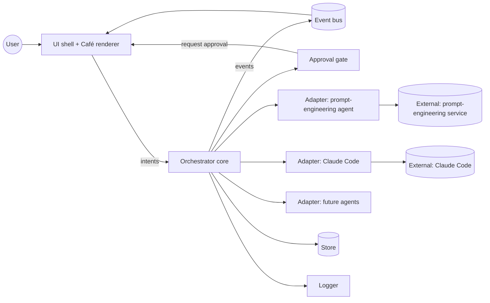
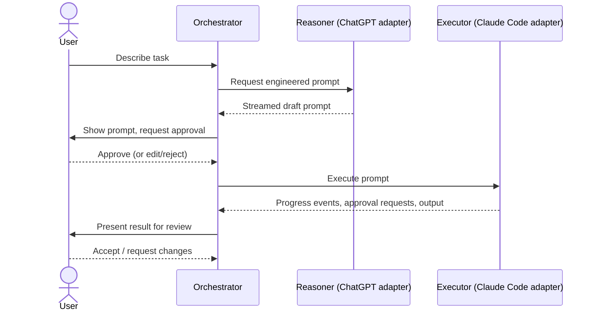
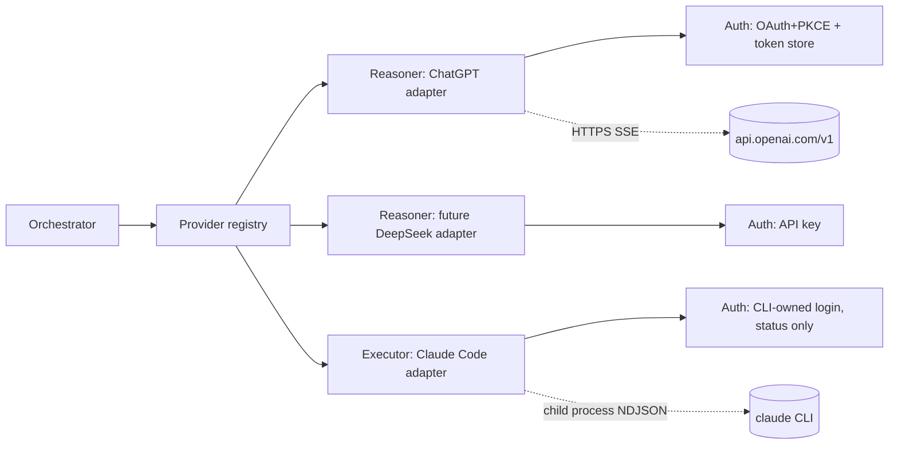

# architecture.md — Mushoku Guild Architecture

> **Status:** the technology stack, MVP scope and provisional budgets are **accepted** (ADR-0010, ADR-0011, ADR-0012, 2026-11-08); the rest of the design is **PROPOSED**. Nothing here is implemented. This document describes the intended shape of the system and is the starting point for Discovery. It must evolve with the real implementation. Items marked **TBD** or *proposed* are undecided (see `docs/DECISIONS.md`).

## 1. System overview

Mushoku Guild is a single-user desktop application that sits between the user and one or more AI agents. It replaces manual copy-paste handoff between a prompt-engineering agent and an executing coding agent, shows what each agent is doing as a game-like "guild café" scene, and gates execution on user approval.

Core idea: **a small, headless orchestration core** (tasks, handoffs, approvals, events) that is independent from **a thin presentation layer** (the café), connected by an event stream. This keeps the heavy "game" concerns out of the logic and lets the UI stay lightweight.

## 2. Major components

| Component | Responsibility | Status |
|-----------|---------------|--------|
| **UI shell** | Desktop window, windowing, input, notifications | TBD |
| **Café renderer** | Draws the scene: characters (agents), orders (tasks), status | TBD |
| **Orchestrator (core)** | Owns task lifecycle, routes work between agents, enforces approval gates | Proposed |
| **Agent adapters** | One per agent type; translate between the orchestrator's neutral interface and a concrete agent | Proposed |
| **Event bus** | In-process publish/subscribe of typed events; single source for the UI | Proposed |
| **Approval gate** | Pauses a task until the user approves/rejects an action | Proposed |
| **Store** | Persists tasks, prompts, events, settings (if persistence is confirmed) | TBD |
| **Config & secrets** | Settings, credential access via OS facilities | Proposed |
| **Logger** | Structured local logging | Proposed |

### Responsibilities in brief

- **Orchestrator** never talks to an agent directly; it uses an adapter.
- **Adapters** hide agent specifics (CLI, API, SDK). Adding an agent = adding an adapter.
- **UI/renderer** only reads events and sends user intents (create task, approve, cancel). It holds no business logic.
- **Approval gate** is part of the core, not the UI, so it cannot be bypassed by a UI bug.

## 3. Technology stack

| Concern | Choice |
|---------|--------|
| Language / runtime | Accepted (ADR-0010): Rust core; TypeScript + React UI |
| Desktop shell | Accepted (ADR-0010): Tauri 2 on WebView2; assumptions verified by the Phase 2 measurement gate |
| Rendering approach for café | Accepted (ADR-0010): PixiJS v8, WebGL renderer, render-on-demand loop (no heavy game engine) |
| Persistence | Accepted (ADR-0010): SQLite via rusqlite (`bundled`) in the Rust core; schema is proposed design (`docs/system-design.md` §2.16) |
| Agent integration — Claude Code | Accepted (ADR-0006): unmodified `claude` CLI as child process, headless stream-json (ADR-0006). Agent SDK not used with subscription auth. |
| Agent integration — prompt engineering agent | Proposed (ADR-0007, ADR-0008, not accepted): ChatGPT via Sign in with ChatGPT plan usage; self-implemented client. Spike succeeded for the user's account (`docs/context.md` §12); Go eligibility not confirmed by OpenAI. |
| Provider abstraction | Proposed (ADR-0009, not accepted), see §6a |
| Packaging / installer | Accepted (ADR-0010): NSIS installer (MSI avoided: needs VBSCRIPT); code signing is a release blocker |
| Test framework | Proposed: `cargo test` (Rust), Vitest (TypeScript); chosen formally in Phase 2 |

Selection criteria (from confirmed constraints): low idle CPU, low RAM, small install size, ease of spawning/streaming from subprocesses, Windows support, maintainability by a small team. Evaluation happens in `docs/plan.md` Phase 1.

## 4. Component interactions



All arrows are **proposed**.

## 5. External integrations

Status of each (facts and sources in `docs/context.md` §11):

| Integration | Purpose | Route | Status |
|-------------|---------|-------|--------|
| ChatGPT (prompt engineering) | Turn a task description into an implementation prompt | Sign in with ChatGPT "plan usage": OAuth+PKCE to `auth.openai.com`, then streaming Responses API at `api.openai.com/v1` | Documented by OpenAI; flow **verified in a spike** (auth, models, streamed inference; refresh/limits untested); **Go eligibility observed, not confirmed by OpenAI**; DevKit licence is noncommercial |
| Claude Code (execution) | Execute the development task | Spawn the user's unmodified `claude -p --output-format stream-json` under their own login (ADR-0006) | **Verified in a spike** (`docs/context.md` §13): discovery, launch, stream-json events, permission denial and approval via an MCP approver, cancellation, login retention. Uses behaviour not covered by official docs (observed on CLI 2.1.319); policy question open |
| Local filesystem / Git | Project working directory, diffs for review | Via Claude Code and/or direct | Not investigated |
| Future providers (e.g. DeepSeek) | Additional Reasoners or Executors | Adapter per provider | Not investigated |

## 6. Agent orchestration model (proposed)

Initial model is a **linear pipeline with human gates**, mirroring the original workflow:



Generalisation to arbitrary agent graphs is **not** in scope until a second real use case exists (see `CLAUDE.md` §4).

## 6a. Provider abstraction (PROPOSED — ADR-0009, not accepted)

Design goals: ChatGPT generates prompts; Claude Code executes them; a new provider (e.g. DeepSeek) is added by writing one adapter and registering it, with no change to the orchestrator, event model or UI. Keep it as small as the two real adapters require (`CLAUDE.md` §4).

Three separate concerns, because the two real providers differ on each:

1. **Auth** (`AuthProvider`): how the user becomes signed in. ChatGPT: app-run OAuth+PKCE with a rotating refresh token that the app must store and refresh. Claude Code: the CLI owns the login; the app only reads status and never touches credentials. A DeepSeek-style provider: an API key from the OS credential store.
2. **Role**: what the provider does for the orchestrator.
   - `Reasoner`: `generate(request) -> Stream<TextEvent>`; stateless; the caller sends the full history and instructions; one streamed text response (ChatGPT, later DeepSeek or others).
   - `Executor`: `start(job) -> Run`; long-running, works inside a project directory, emits progress, may ask for approvals, can be cancelled, ends with an outcome (Claude Code).
3. **Capabilities** (`ProviderInfo`): declared, not assumed — roles supported, auth kind, streaming, model discovery, whether sampling parameters or token limits are accepted, whether it can request approvals. The UI and orchestrator read these instead of hard-coding provider names.

A **registry** maps provider IDs to adapters; configuration chooses which provider fills which role. All adapters map their native errors into one shared taxonomy (`not_signed_in`, `not_eligible`, `usage_limit`, `transient`, `unsupported`, `cancelled`, `failed`) so retry policy and UI messages are provider-independent. Details: `docs/system-design.md` §2.2.



Recommended integration summary: ChatGPT via a self-implemented, small OAuth+PKCE and Responses-SSE client (subject to the licence/terms review, ADR-0008) behind the Reasoner role; Claude Code via a child process in headless stream-json mode behind the Executor role (ADR-0006).

## 6b. Claude Code executor: launch, approval and cancel model (PROPOSED design; behaviour verified in a spike, `docs/context.md` §13)

```mermaid
sequenceDiagram
    participant App as Mushoku Guild (Executor adapter)
    participant CLI as claude.exe (-p, stream-json)
    participant Ap as Approver MCP server (child of CLI)
    App->>App: discover claude.exe, check version, signature, auth status
    App->>CLI: spawn (cwd=project, scrubbed env, prompt on stdin)
    CLI-->>App: system/init, assistant, tool_use ... (NDJSON on stdout)
    CLI->>Ap: tools/call approve {tool_name, input, tool_use_id}
    Ap->>App: forward request (loopback socket / named pipe)
    App->>App: user approves or denies in the UI
    App-->>Ap: decision
    Ap-->>CLI: {"behavior":"allow"|"deny", ...}
    CLI-->>App: user tool_result, assistant text, result
    Note over App,CLI: Cancel: stream-json interrupt, close stdin, wait; else taskkill /T /F on the tree
```

- **Discovery:** user override → `PATH` search for `claude.exe` → `%USERPROFILE%\.local\bin\claude.exe`; validate with `--version`, Authenticode signature (Anthropic, PBC) and `claude auth status`. Shims and `System32\bash.exe` (WSL) are never used.
- **Launch:** `spawn(exe, args, {cwd, env: scrubbed, windowsHide, shell:false})`, prompt on stdin, always `--strict-mcp-config` plus only the app's own MCP config, explicit `--tools`, `--max-turns`, no `--dangerously-skip-permissions`.
- **Approval (experimental, CLI 2.1.319-specific):** default is deny; per-action approval through `--permission-prompt-tool` pointing at a small approver MCP server that bridges to the app (extra child process per run). Pre-approved tool lists (`--allowedTools`) remain an option for low-risk steps.
- **Cancel (graceful interrupt is experimental, CLI 2.1.319-specific):** graceful `interrupt` control request over stream-json input, then `taskkill /PID … /T /F` on the tree as fallback; treat a stream without `result` as aborted.
- **Outcome:** decided from the `result` event (`subtype`, `is_error`, `terminal_reason`, `permission_denials`), not from the exit code.
- **Limits:** relies on undocumented-but-observed behaviour in CLI 2.1.319 (interrupt message, approver contract, event fields). Not decided: whether to use a long-lived stream-json process per project or one process per task; this needs idle-cost measurement.

## 7. Data flow

1. User intent enters via the UI → orchestrator creates a Task.
2. Orchestrator emits `TaskCreated`; renderer shows a new order.
3. Adapter calls produce a stream of events (`AgentStarted`, `AgentOutput`, `AgentFinished`, `AgentFailed`).
4. Approval gate emits `ApprovalRequested`; execution blocks until `ApprovalGranted/Denied`.
5. Events are appended to the store (if persistence is adopted) and fanned out to the UI.
6. The renderer maps events to scene state (e.g. character busy/idle, order progress).

Event and entity details: `docs/system-design.md`.

## 8. Deployment architecture

- Single local desktop process (plus child processes for agents). No server component, no cloud backend assumed (assumption A4 in `docs/context.md`).
- Target platform: Windows 11 at minimum; others TBD.
- Distribution: proposed NSIS installer; auto-update deferred (post-MVP); signing is a release item (`docs/context.md` §15.4).

## 9. Resource budget (ACCEPTED as provisional engineering targets — ADR-0012; first measurements in §13; amendment A proposed)

Reference machine: i5-10300H (4C/8T), 15.8 GB RAM, Intel UHD + GTX 1650, Windows 11. **The targets below are the original ADR-0012 numbers, kept unchanged; the Phase 2 measurements against them are in §13 (the two RAM rows fail as literally defined; amendment A — private working set, 120/140 MB — was ACCEPTED by the owner on 2026-11-08, see ADR-0012).** The user accepted these as provisional engineering targets with binding qualifications: (1) **measure, do not assume**; (2) **stability and security take priority** over meeting any number; (3) if a target is unrealistic, **document the evidence and propose a revised target** for approval; (4) **`claude.exe` and its children are measured and reported separately** from Mushoku Guild's own usage. They were chosen to be meaningfully lighter than the agent the app launches (`claude.exe` used about 200–285 MB for a small run, `docs/context.md` §13.8) and are verified or revised by the Phase 2 measurement gate. "Mushoku Guild process tree" means the Tauri app process plus all WebView2 processes it owns, **excluding** `claude.exe` and its children (the user's tool).

Assumption (confirmed by the user's direction): **one Reasoner request and one Executor run at a time.** Multiple simultaneous coding agents are not a goal, and the budgets assume none.

| Metric | Target | Hard limit (triggers redesign review) | How measured |
|--------|--------|--------------------------------------|--------------|
| Cold start to interactive window | ≤ 2.5 s | 4 s | 5 cold and 5 warm launches; time from process start to first interactive frame |
| Installer size (NSIS, WebView2 downloadBootstrapper, with MVP art) | ≤ 15 MB | 30 MB | Build output |
| Installed size on disk | ≤ 60 MB | 120 MB | Folder size |
| Idle RAM (café visible, focused, nothing running) | ≤ 180 MB | 250 MB | Sum of working set of the process tree, 60 s window, 3 runs |
| Active RAM (task running, text streaming, scene animating) | ≤ 260 MB | 350 MB | Same, during a scripted task |
| RAM growth over 8 h with periodic tasks | ≤ +50 MB | +120 MB | Soak test with sampled working set |
| Idle CPU, focused, ambient animation on | ≤ 2% of total CPU | 4% | 60 s average via process-tree sampling |
| Idle CPU, window hidden/minimised/unfocused | ≤ 0.3% | 1% | Same; rendering must be fully stopped |
| Active CPU (streaming + animation) | ≤ 8% average, ≤ 15% peak | 15% / 25% | Scripted task |
| Frame rate | ≤ 30 fps active, ≤ 15 fps ambient idle, 0 fps hidden | — | Pixi ticker settings; frame counter |
| GPU use | Prefer integrated GPU; ≤ 5% utilisation in active scene | — | Task Manager/perf counters |
| Process count (our tree) | ≤ 8 | 12 | Process snapshot |
| Idle disk writes | 0 per minute | — | Process I/O counters |
| Event latency (core event → visible in UI) | ≤ 100 ms p95 | 250 ms | Instrumented timestamps |
| SQLite size | Bounded by retention (e.g. last 500 tasks / 90 days of events) | — | Retention job test |

Design rules that follow: event-driven (no polling); Channels with coalescing for streams; Pixi ticker stopped when hidden or idle; textures in spritesheets and unloaded when unused; bounded in-memory logs and event history; a "lite" mode (static scene, no animation) that the user can pick. The measurement method (PowerShell/CIM process-tree sampling) was exercised in the Claude CLI spike and must be replaced by a more precise counter in the gate if needed.

## 10. Open architectural questions

See `docs/context.md` §8. Notable: whether the orchestrator and renderer share a process, how agents are sandboxed/permissioned, and the persistence model.

## 11. Technology stack evaluation (Phase 1 closure) — ACCEPTED (ADR-0010, 2026-11-08)

Status: **accepted by the user (ADR-0010, 2026-11-08); this section records the evaluation behind the decision.** This section evaluates the stack the user proposed (Tauri 2, React + TypeScript, PixiJS, Rust, SQLite) for Windows, lightweight resource use, developer experience and the integration needs found in the spikes. Evidence labels: **[doc]** = stated in official documentation fetched 2026-11-08; **[local]** = observed on the user's machine; **[general]** = general engineering knowledge, not verified or measured here; **[gap]** = the official docs are silent. **No Tauri, WebView2 or PixiJS resource number has been measured.**

### 11.1 Environment facts
- [local] i5-10300H (4 cores / 8 threads), 15.8 GB RAM, Intel UHD Graphics plus NVIDIA GTX 1650 (hybrid graphics), Windows 11, 115 GB free on `D:`.
- [local] WebView2 Evergreen runtime 157.0.4341.42 is installed. **Rust, Cargo and the MSVC C++ Build Tools were not detected**; Node 24, npm and pnpm are present. Phase 2 therefore begins with a toolchain install (Tauri requires the C++ Build Tools and Rust MSVC toolchain [doc]).

### 11.2 Component assessment

| Component | Verdict | Evidence and reasoning |
|-----------|---------|------------------------|
| **Tauri 2** (shell) | Accepted (ADR-0010); assumptions verified by the Phase 2 measurement gate | [doc] MIT/Apache-2.0; latest stable crate 2.12.3 (Oct 2026); uses the OS WebView (WebView2 on Windows) so no browser engine is bundled; NSIS and MSI installers; `downloadBootstrapper` adds +0 MB (the WebView2 runtime ships with Windows 11 and nearly all Windows 10); capabilities, CSP and an isolation pattern for the frontend/backend boundary; Channels recommended for streaming; single-instance and tray plugins exist. [gap] no official memory/CPU/size comparison with Electron; no statement on suspending a hidden webview. [doc] The multi-process WebView2 model still means several processes per app; no per-app footprint is published. |
| **Rust** (core) | Recommended | [doc] Tauri core owns state and DB connections; async commands; process spawn, SSE, loopback listener, OAuth and SQLite all fit a headless core that matches the architecture (`docs/architecture.md` §1). [general] Strong fit for reliable child-process and Win32 work (Job Objects, tree kill). Cost: steeper learning curve; slow cold builds; toolchain install (~GBs for MSVC build tools). |
| **React + TypeScript** (UI) | Acceptable; low risk | [general] The UI is small (panels, forms, approval dialogs, history). Framework weight is negligible next to the WebView2 runtime, so the choice is about developer experience. Alternatives (Preact, Solid, Svelte) are lighter but add no decisive benefit. Keep the PixiJS scene **outside** React's render cycle (an imperative scene controller fed by core events) so React re-renders never touch the render loop. |
| **PixiJS v8** (café renderer) | Recommended with limits | [doc] v8.22.0, MIT; WebGL renderer is the production default and WebGPU is experimental, so use WebGL; `Ticker` supports `stop()`/`start()` and `maxFPS`; `renderer.render()` can render a stage manually; `Application` accepts `powerPreference` (`low-power`/`high-performance`), `autoStart`; spritesheets and texture unloading are documented. [gap] AnimatedSprite and render-on-demand are not documented in the pages read (verify in the gate); no official bundle size; the docs contradict themselves on the manual-render signature. [general] A GTX 1650 and iGPU are far beyond what a small 2D café needs; the real concern is keeping the loop idle, not GPU power. |
| **SQLite via `rusqlite`** (persistence) | Recommended; use from the Rust core, not the frontend plugin | [doc] rusqlite 0.41.x, MIT, `bundled` feature recommended on Windows (bundles SQLite 3.54); `tauri-plugin-sql` (sqlx) exposes the DB to the frontend and needs extra permissions; Tauri's process-model page says the core should own database connections. [gap] Tauri docs do not mention rusqlite; rusqlite docs give no WAL guidance (use SQLite's own WAL documentation). Keeping the DB behind core-only commands means a compromised frontend cannot read history directly. |

### 11.3 Alternatives considered (qualitative; unmeasured [general])

| Option | Idle RAM / size expectation | 2D café ease | Windows fit | Integration fit | Verdict |
|--------|----------------------------|--------------|-------------|-----------------|---------|
| **Tauri 2 + WebView2 + Pixi** | Moderate (WebView2 process group); small installer | High (web tooling, sprites) | High | High (Rust core) | **Accepted (ADR-0010); verified by the Phase 2 gate** |
| Electron | Higher (bundles Chromium) | High | High | High (Node) | Rejected: contradicts the lightweight goal; Chromium bundled |
| .NET (WPF/WinUI) + SkiaSharp/Win2D | Possibly the lightest *Windows-only* option; no browser | Medium (custom sprite loop) | Very high; Windows-only | High (C#; Credential Manager, Job Objects natively) | **Named fallback** if the Tauri gate fails; ties the product to Windows |
| Rust-native (egui/iced/Slint) | Low | Low–medium (sprite scenes are awkward; immediate-mode redraw costs) | High | High | Not chosen: weaker art/animation workflow |
| Godot / game engine | Higher baseline, engine runtime | Very high | High | Medium | Rejected: the user ruled out heavy engines; UI-heavy approval flows fit poorly |
| Qt/QML | Moderate; licensing (LGPL/commercial) complexity | Medium | High | Medium | Not chosen: licensing and tooling weight |

### 11.4 Risks specific to this stack
1. **WebView2 memory is unmeasured.** The lightweight requirement depends on measurements, not documentation. Mitigation: a Phase 2 **measurement gate** (below) that must pass before any feature work.
2. **Hidden/minimised behaviour.** WebView2 documents `IsVisible=false` (CPU/memory benefits, caches purged), `TrySuspend` and `MemoryUsageTargetLevel` [doc], but whether Tauri 2 exposes them is **unverified**. Fallback in app code: stop the Pixi ticker and all CSS animation when the window is hidden, unfocused or minimised.
3. **Hybrid GPU laptop.** Which GPU WebView2 uses follows Windows graphics settings [general]; prefer the integrated GPU for a tiny scene (`powerPreference: 'low-power'` hint). To be checked in the gate.
4. **Toolchain weight and Rust learning curve** (the Rust and C++ build tools are not installed here).
5. **Streaming throughput.** Tauri events are not designed for high throughput or ordering [doc]; use Channels for token/tool streams and coalesce updates.
6. **Security surface.** Tauri protects against frontend compromise only if capabilities are minimal and CSP is set [doc]; it does not protect against malicious Rust code, WebView zero-days or supply chain attacks. Do the process, credential and DB work in Rust and expose a narrow command set (no frontend shell, fs or SQL permissions).
7. **Distribution.** Unsigned installers trigger SmartScreen warnings and are blocked by Smart App Control [doc]; MSI needs VBSCRIPT, so prefer NSIS.
8. **Docs/version churn.** Tauri plugins require recent Rust (1.90+ [doc]); pin toolchain versions.

### 11.5 Final recommendation
Proceed with **Tauri 2 + Rust core + SQLite (rusqlite) + TypeScript UI (React) + PixiJS (WebGL)**, with these refinements: (a) the Rust core owns the orchestrator, providers, processes, OAuth, credential storage and SQLite; the frontend is a thin projection and never gets shell/fs/SQL access; (b) the café is an imperative PixiJS scene driven by a render-on-demand loop with 0 fps when hidden; (c) NSIS installer; (d) the Phase 2 measurement gate verifies the assumptions against the budgets in §9; if it shows a target is unrealistic or that stability or security would be compromised, the evidence is documented and a revision (including the .NET + Skia fallback) is proposed to the user. Accepted as ADR-0010.

### 11.6 Proposed module layout (illustrative, not final)
```
src-tauri/            Rust workspace: core (orchestrator, events, approval gate), providers/{chatgpt,claude_cli}, store (rusqlite), config/secrets, commands (IPC)
src/                  TypeScript UI: panels, approval dialogs, history; cafe/ (PixiJS scene controller)
```

## 12. Development environment record (Phase 2, task 2.0 — measured/observed 2026-11-08)

Reference machine: Windows 11 Home 10.0.26200, i5-10300H (4C/8T), 15.8 GB RAM, Intel UHD + GTX 1650, `C:` ~15.6 GB free and `D:` ~111 GB free after the installs.

| Tool | Version | Location / note |
|------|---------|-----------------|
| Rust (stable, `x86_64-pc-windows-msvc`, minimal profile) | rustc 1.99.1 (2026-10-13), cargo 1.99.1 | `D:\toolchains\rustup`, `D:\toolchains\cargo` (user env `RUSTUP_HOME`, `CARGO_HOME`, `PATH` set); rustup-init verified against Rust's published SHA-256 (the binary is not Authenticode-signed) |
| Microsoft C++ Build Tools | VS Build Tools 17.14.44, MSVC toolset 14.44.35207 (`cl`/`link` 14.44.35229) | `D:\toolchains\BuildTools2022`; only components `VC.Tools.x86.x64` and `Windows11SDK.22621`; bootstrapper signed by Microsoft |
| Windows SDK | 10.0.22621.5040 | `D:\Windows Kits\10` (chosen by the installer; not on `C:`) |
| WebView2 runtime | 157.0.4341.42 (Evergreen) | system |
| Node.js / pnpm | 24.13.0 / 11.22.0 | pnpm store on `D:\.pnpm-store` |

Install footprint: Build Tools ≈ 1.6 GB on `D:`; Rust ≈ 0.7 GB on `D:`; SDK on `D:`; `C:` was not meaningfully consumed.

**Known environment issue (tooling, not design):** I installed with a temporary Visual Studio setup policy that moved the package cache to `D:` (to protect the 12 GB `C:`), and removed the policy afterwards. The instance registration therefore sits in `D:\toolchains\vs-cache\_Instances\21e3d51a` instead of `C:\ProgramData\Microsoft\VisualStudio\Packages\_Instances`, so `vswhere` and `rustc`'s automatic MSVC discovery find nothing. Verified workaround: run builds inside the developer environment (`D:\toolchains\BuildTools2022\VC\Auxiliary\Build\vcvars64.bat`), after which `cargo build` links correctly. Optional permanent fix (needs an elevated prompt): `robocopy D:\toolchains\vs-cache\_Instances\21e3d51a C:\ProgramData\Microsoft\VisualStudio\Packages\_Instances\21e3d51a /E`. The one attempt to run this automatically was cancelled at the UAC prompt; nothing was forced.


## 13. Phase 2 measurement gate (tasks 2.3–2.6) — results of 2026-11-08

Everything in this section is **measured** unless explicitly labelled *not measured* or *inference*. Method, environment, scenario definitions, file inventory and known limits: `docs/measurements/phase2/README.md`. Raw data: `docs/measurements/phase2/raw/`. The numbers describe the **final** build (`final2` tag): Tauri 2.12.5, release profile, WebView2 157.0.4341.42, reference laptop on AC power. Mushoku Guild's own process tree only (app + 6 WebView2 processes); `claude.exe` is **not** included (ADR-0012 qualification 4).

### 13.1 Results (3 runs per scenario; mean of run means, with the range of run means in brackets)

| Scenario | Startup to first frame | CPU, % of total machine | Summed working set | Private working set | Processes | Scene steps / draws per second |
|----------|-----------------------|------------------------|--------------------|--------------------|-----------|-------------------------------|
| Blank (Tauri + React, no Pixi) | 860 ms (829–902) | 0.037% (0.031–0.044) | 355 MB | 84 MB | 7 | – |
| Static scene (drawn once) | 955 ms (907–994) | 0.060% (0.048–0.071) | 370 MB | 94 MB | 7 | 0 / 0 |
| **Ambient idle, focused** | 889 ms (874–898) | **0.313%** (0.236–0.371); worst 1 s sample 3.54% | 371 MB | **90 MB** | 7 | 2.91 / 2.91 |
| **Minimised** | 938 ms (911–974) | **0.051%** (0.032–0.088) | 370 MB | 91 MB | 7 | 0 / 0 |
| Hidden from outside the app (`SW_HIDE`) | 938 ms (926–948) | 0.327% (0.242–0.446) | 371 MB | 90 MB | 7 | 2.90 / 2.90 |
| **Active** (30 fps scene + 60 events/s over a Channel) | 964 ms (940–979) | **4.25%** (3.99–4.47); worst 1 s sample 6.90% | 377 MB | **96 MB** | 7 | 29.55 / 29.55 |

- **Event latency** (core → UI, 2,700 events per run, 3 runs): p50 0.52–0.63 ms, p95 1.49–1.56 ms, p99 about 2.0 ms, max 4.0–12.0 ms, **0 gaps/reordering**. Same-machine clocks, so about 1 ms of clock uncertainty.
- **Installer:** `Mushoku Guild_0.0.0_x64-setup.exe` = 1,334,774 bytes (**1.27 MiB**), unsigned, `downloadBootstrapper` WebView2 mode. **Installed size 3.25 MB** (`mushoku-guild.exe` 3,326,976 bytes + `uninstall.exe`); the Evergreen WebView2 runtime is a shared system component and not part of it. A silent install took 1.6 s; the installed copy launched and reported ready in 1.16 s; uninstall (exit 0) removed the files, the HKCU uninstall entry and the Start Menu shortcut. The app's WebView2 data folder under `%LOCALAPPDATA%` is left behind by a silent uninstall (normal NSIS behaviour; the interactive uninstaller offers to delete it) and was removed manually after the test.
- **GPU (task 2.5):** in idle, minimised and active states every GPU engine instance belongs to the **NVIDIA GTX 1650**, utilisation reads 0% (integer counter, so "small", not "zero"); the Intel UHD is never used by default, although the page asked for `powerPreference: 'low-power'`. See findings F5/F6.
- **Release binary:** 3,326,976 bytes; frontend bundle about 750 KB uncompressed (about 220 KB gzip), mostly PixiJS.

### 13.2 Comparison with ADR-0012 (provisional targets)

| ADR-0012 metric | Target / hard limit | Measured | Verdict |
|-----------------|--------------------|----------|---------|
| Cold start to interactive | ≤ 2.5 s / 4 s | 0.83–0.99 s per run (warm WebView2 profile; first-ever launch and cold-boot not separately measured) | **Pass** (qualified) |
| Installer size | ≤ 15 MB / 30 MB | 1.27 MiB | **Pass** |
| Installed size | ≤ 60 MB / 120 MB | 3.25 MB (excluding the shared WebView2 runtime) | **Pass** |
| Idle RAM, **sum of working sets** | ≤ 180 MB / 250 MB | 371 MB (blank page: 355 MB) | **Fail as defined**; see F4 |
| Active RAM, sum of working sets | ≤ 260 MB / 350 MB | 377 MB | **Fail as defined**; see F4 |
| (same, **private** working set; not the ADR's wording) | (same numbers) | idle 90 MB, active 96 MB (blank: 84 MB) | Within targets |
| RAM growth over 8 h | ≤ +50 MB / +120 MB | *not measured* | **Open** |
| Idle CPU, focused, ambient animation | ≤ 2% / 4% | 0.31% | **Pass** |
| Idle CPU, hidden/minimised/unfocused | ≤ 0.3% / 1% | minimised 0.051% (pass); hidden from outside the app 0.33% (marginally above target, below limit; the app cannot see that); visible-but-unfocused *not measured* | **Pass for minimised; partly open** |
| Active CPU | ≤ 8% / 15% | 4.25% mean, 6.9% worst second | **Pass** |
| Frame rate | ≤ 30 fps active, ≤ 15 fps ambient, 0 hidden | 29.55 fps active; ambient 2.91 timer steps/s (no animation-frame loop); 0 when minimised | **Pass** |
| GPU use | integrated GPU preferred; ≤ 5% | discrete GPU in use; utilisation 0% | Utilisation **pass**; adapter preference **not met by default** (F5) |
| Process count | ≤ 8 / 12 | 7 (one earlier invalid run showed 9) | **Pass** |
| Idle disk writes | 0 per minute | *not measured* | **Open** |
| Event latency | p95 ≤ 100 ms / 250 ms | p95 ≈ 1.5 ms | **Pass** |
| SQLite size | bounded by retention | not applicable yet | – |

### 13.3 Findings (each backed by a recorded measurement)

- **F1 — WebView2 does not tell the page that its window is minimised or hidden.** `document.hidden` stayed `false`, no `visibilitychange` fired, and the page kept animating at full rate while minimised or `SW_HIDE`-hidden. Fix implemented: the Rust core publishes a `window-minimized` event (from the window's resize events) and the scene stops; frames measured 24 → 24 across 5 s while minimised and resumed at the normal rate on restore. A window hidden by *other software* cannot be detected this way; a window the app hides itself is known to the app.
- **F2 — PixiJS's internal system ticker costs 1.7% of total CPU on its own.** With the scene "stopped" (my ticker stopped, 0 frames) CPU was still 1.72% against 0.05% for a blank page. Per-process snapshots put the cost in the GPU process (~1.0%) and renderer (~0.4%). Hiding the canvas, detaching it, or losing the WebGL context changed nothing; destroying the Pixi app, or stopping `Ticker.system` alone, brought it to 0.05%. Pixi starts that ticker for its event system; it polls on `requestAnimationFrame`.
- **F3 — any `requestAnimationFrame` loop costs about the same regardless of Pixi's `maxFPS`.** Capping the render loop at 15, then 8 ticks/s (and 6, then 3 draws/s with render-on-demand) left CPU at 1.9–2.5%. `maxFPS` only skips work inside the callback; the browser still wakes at display rate. A plain `setTimeout` loop that changes the pose ~3 times per second and draws only then costs **0.31%**. Rule adopted in the scene controller: no rAF loop in idle states; rAF only in active mode.
- **F4 — "sum of working sets" is the wrong memory metric for WebView2.** The seven processes share most of their pages: a blank page already sums to 355 MB, but its private working set is 84 MB. The ADR-0012 wording cannot be met with this stack by any app on this machine; the app's own contribution is about 6 MB private (blank 84 → idle 90 → active 96 MB). Proposal in `docs/DECISIONS.md` (ADR-0012 amendment A, **proposed, not accepted**).
- **F5 — GPU choice does not explain CPU use, and the default is the discrete GPU.** WebView2's GPU process used the GTX 1650 regardless of `powerPreference: 'low-power'` (Chromium on Windows does not act on that hint here; *inference* from the observation). With the Windows graphics preference for the WebView2 runtime temporarily set to "power saving" (set, tested, removed; the original "none" was restored and checked), the Intel UHD showed 3D activity, CPU did not change (static 1.63%, ambient 2.16% vs 1.72%/2.18% in the same period), private memory **rose** from 93 to 118 MB (integrated GPU uses system RAM) and startup slowed from about 1.0 s to 1.1–1.2 s. Conclusion: leave the default; do not ship a GPU-preference hack. The per-app Windows setting is keyed to the versioned runtime path, so it would not be maintainable anyway.
- **F6 — GPU load is negligible.** 0% on every engine in idle, minimised and active states for a 640×360 scene. The cost of this scene is CPU wake-ups (F2/F3), not GPU work.
- **F7 — WebView2 does not trim memory by itself when minimised** (private working set 91 MB minimised vs 90 MB focused). WebView2's `TrySuspend` and `MemoryUsageTargetLevel` are **reachable**: `WebviewWindow::with_webview` exposes `PlatformWebview::controller()` (an `ICoreWebView2Controller`) in tauri 2.12.5, and the `webview2-com` bindings in the lockfile contain both APIs (verified by reading the sources). They were **not exercised**, because that needs a direct `webview2-com`/`windows` dependency; their benefit is unknown and not needed to meet any CPU target.
- **F8 — Tooling facts for the repository.** (a) Tauri's own NSIS download timed out on this connection (about 110 KB/s); the same official files were fetched manually and verified against the SHA-1 hashes pinned in Tauri's bundler source before being placed in `%LOCALAPPDATA%\tauri\NSIS`, after which bundling worked. (b) Windows focus cannot be reliably taken from the app by the harness (foreground lock), so the visible-but-unfocused state is unmeasured. (c) A synthetic Alt key tap used to steal focus stalls the WebView page; the harness no longer uses it.

### 13.4 Implementation vs the proposed design (documentation drift check)

| Proposed (docs before Phase 2) | Actual |
|--------------------------------|--------|
| "Pixi ticker stopped when hidden/minimised/unfocused", one ticker | Two Pixi tickers exist; scene regimes are *stopped / ambient (timer) / active (rAF)*; system ticker always stopped. Window minimisation comes from a Rust event, not from the page. |
| "Render-on-demand loop" | Implemented: the scene draws only on change (ambient: per pose step; active: per tick); Pixi's automatic render-every-tick listener is removed. |
| Frontend ↔ core contract: commands + one ordered Channel | Implemented: `app_info` command, `bench_stream` Channel, one `window-minimized` event. Event payloads are not coalesced yet (no real streams exist). |
| No shell/filesystem/SQL access from the frontend | Holds: capability is `core:default` only. The `bench_*` commands write only to the path given by the harness environment variable and are inert otherwise; **they are Phase 2 measurement fixtures and must be removed or gated behind a Cargo feature before Phase 3** (tracked in `docs/plan.md`). |
| CSP / isolation / single-instance | **Not done** (task 2.8, on hold): `app.security.csp` is `null`. |
| Lint/format/test tooling | **Not done** (task 2.7, on hold): no `rustfmt`/`clippy`/ESLint/Prettier/test runners installed or run. Only `tsc --noEmit` (strict) and compiler warnings (none) were checked. |

### 13.5 Gate verdict

**The stack is viable and no budget is missed in a way that threatens stability or security.** Startup, installer/installed size, CPU in every state the app can detect, frame rates, process count and event latency meet the ADR-0012 targets with large margins. The two RAM rows fail *as literally defined* (sum of working sets) because that metric cannot be satisfied by a blank WebView2 page on this machine; by private working set the app uses 90–96 MB. Open or unmeasured: memory growth over hours, idle disk writes, the visible-but-unfocused state, the first-ever-launch start-up, and real-world numbers once providers, SQLite and real art exist. Nothing found requires the .NET + Skia fallback. **The decision to continue, and the ADR-0012 amendment, are the user's** (`docs/DECISIONS.md`).

### 13.6 Environment quirks recorded for reproducibility
Builds currently run inside the Visual Studio developer environment (`vcvars64.bat`) because the Build Tools instance registration is not in the standard `C:\ProgramData` location (§12). `cargo build --release` of the whole stack takes about 4 m 42 s cold and about 1 m 17 s incrementally; debug cold build 8 m 09 s.

## 14. Dependencies and repository structure after Phase 2 (tasks 2.0–2.6)

**Direct dependencies (all exact-pinned via lockfiles; every one is part of ADR-0010):**

| Ecosystem | Package | Version | Why |
|-----------|---------|---------|-----|
| Rust | `tauri` | 2.12.5 | Application shell, IPC, windowing (ADR-0010) |
| Rust | `tauri-build` | 2.7.4 | Build script required by Tauri |
| Rust | `serde`, `serde_json` | 1.0.229, 1.0.154 | Typed IPC payloads |
| npm (runtime) | `react`, `react-dom` | 19.3.1 | UI (ADR-0010) |
| npm (runtime) | `pixi.js` | 8.22.0 | Café scene (ADR-0010) |
| npm (runtime) | `@tauri-apps/api` | 2.12.4 | Typed access to Rust commands/events |
| npm (dev) | `typescript` 7.0.2, `vite` 8.3.6, `@vitejs/plugin-react` 6.2.1, `@types/react` and `@types/react-dom` 19.3.0, `@tauri-apps/cli` 2.12.4 | | Build and type-check |

`src-tauri/Cargo.lock` locks **404 packages** (almost all transitive via Tauri). Not yet reviewed: Tauri's default features compile `muda` (menus) and pull in `tray-icon`, which this app does not use; the feature/dependency audit is part of task 2.7/2.8 and is **not** done. The Rust toolchain, Build Tools, WebView2 and Node/pnpm versions are in §12.

**Repository structure (code added in Phase 2):**
```
index.html, package.json, pnpm-lock.yaml, tsconfig.json, vite.config.ts
src/                  main.tsx, App.tsx, ipc.ts, bench.ts, styles.css, cafe/CafeScene.ts
src-tauri/            Cargo.toml, Cargo.lock, build.rs, tauri.conf.json, capabilities/default.json, icons/ (placeholder), src/{main,lib,bench}.rs
tools/measure/        measure.mjs, sampler.ps1, window.ps1   (Phase 2 measurement harness)
docs/measurements/phase2/   README.md, raw data, summaries
```

## 15. Phase 3 implementation record (2026-11-08) — status: implemented; `docs/plan.md` says what is verified
- **Rust modules** (`src-tauri/src/`): `db` (rusqlite, versioned migrations, WAL, quick_check with move-aside recovery, task state machine, bounded events: 1500 per execution, last 40 executions), `secrets` (Credential Manager, chunked), `chatgpt` (OAuth + PKCE, loopback listener on 127.0.0.1:1455 else an ephemeral port, ID-token iss/aud/exp/nonce checks; the signature is not re-verified because the token arrives from the token endpoint over TLS, OIDC Core 3.1.3.7(6); only the refresh token is stored, the access token lives in memory), `claude` (detect, spawn, stream normalisation, Job Object cleanup, approval server), `approver` (stdio MCP server, same exe), `commands` (the only frontend surface), `events` (single ordered `mg-event` stream).
- **Security:** the frontend has no shell, filesystem or SQL access; capabilities remain `core:default`; strict CSP (Pixi `unsafe-eval` build); the child environment drops `CLAUDE*` session variables and `ANTHROPIC_API_KEY`/`AUTH_TOKEN`; `--strict-mcp-config`, `--setting-sources project,local`, `--disable-slash-commands`, never `--dangerously-skip-permissions` (unit-tested); approval timeout 10 minutes, then deny.
- **Execution policies:** read-only (tools Read/Glob/Grep, any other request denied), ask-each (default), accept-edits (`--permission-mode acceptEdits`, Bash still asks).
- **Scene:** no rAF loop; one timer (66 ms walking, 220 ms working poses, 500 ms idle); stops when minimised or hidden; the GPU draw is skipped when nothing changed.
- **Measured:** `docs/measurements/phase3/README.md`.
- **Known gaps:** no single-instance guard; the ChatGPT revocation endpoint is not called on disconnect; ChatGPT cancel takes effect at the next stream line; no code signing.

## 16. Model selection, project context, welcome (2026-11-08) — status: implemented and verified in the running app
- **Claude model:** setting `claude_model` in {sonnet, opus, haiku, default}; unset or unknown resolves to **Sonnet**; `default` passes no `--model`. Resolved in Rust (`claude::resolve_model`) on every run start and passed as `--model`; Claude Code stays the authority on availability (its error is shown in the result card). Tests: `claude::tests`, `commands::tests`, `src/domain/model.test.ts`.
- **Project context** (`src-tauri/src/project_context.rs`): collected locally on project select or on demand, cached per project with a cheap fingerprint (manifest/doc mtimes, git HEAD) giving ready / stale / unavailable. Content allowlist: manifests (package.json summarised: scripts and dependency names; Cargo.toml incl. src-tauri/, pyproject, requirements, pom, gradle, go.mod, composer, Gemfile, tsconfig, pubspec, CMake, Makefile, docker-compose), overview docs (README, CLAUDE.md, AGENTS.md, ARCHITECTURE, CONTRIBUTING, docs/architecture.md), git branch / last 8 commits / working-tree status (git run with fsmonitor and hooks disabled), entry points, key directories, depth-3 tree. Never read or listed: `.env*`, keys/certificates, names containing credential/secret/password/private/token, databases, logs, archives, binaries, images; directories `node_modules .git target dist build out venv .venv __pycache__ .next vendor .cache …` and dot-directories. Symlinks are never followed and every file must canonicalise under the project root. Secret-looking strings (private keys, JWTs, `sk-`/`ghp_`/AKIA/xox tokens, `key=value` pairs, URL credentials) are redacted. Caps: 26,000 characters total, 5,000 per doc. The text is embedded in ChatGPT's instructions only when a prompt is requested; if collection fails the instructions say the context is unavailable and forbid assuming a stack.
- **Welcome:** `src/domain/welcome.ts` (dialogue, wrapping, one-per-launch gate) + a 2x pixel-font speech bubble in `CafeScene.welcome()`. It never changes poses, is dropped when a real task appears, and is skipped while the window is paused.

## 17. Sprint 2: execution lifecycle, Guild Chat, research, Auto Pilot (2026-11-08) — status: implemented; verified in the running app unless noted
- **Execution lifecycle (bug fix).** Root cause: the supervisor waited for `claude.exe` to exit before writing the terminal state, but the CLI stays alive after its final `result` while a background tool (for example a dev server started by "launch the website") is still running, so no terminal event was ever emitted and the UI kept showing "Claude Code is working". Fix (`claude::resolve_run`, `finish_run`): the `result` event ends the quest; the process is then asked to stop (stdin closed, 3 s grace, then the Job Object kills the tree, which also stops background servers the quest started). Exactly one `run_finished` event per run (once-guard in Rust, write-once `UPDATE ... WHERE status='running'` in SQLite) carries the outcome, the execution id and the final exit code; a process that dies without a result is `failed` with its exit code and stderr tail; cancel wins only when requested. The UI applies it for any open task, hides Cancel when status leaves `running`, and re-reads the task from Rust every 5 s while it shows `running`. Interrupted runs are reconciled at start-up. Tests: `claude::tests` (`resolve_run` scenarios), `db::tests`, `store.test.ts`. Verified: a quest that starts a background server now ends Completed; cancel ends Cancelled with exit code 1 and no stray processes. Consequence to know: servers started by a quest do not outlive it.
- **Speech bubbles.** `domain/bubble.ts` (size from wrapped text: at most 18 characters x 3 lines, about 80x30 px; placement above the speaker, nudged away from the other character and the quest board, clamped to the scene) and a compact 1x pixel-font bubble with a two-step fade. Tests: `bubble.test.ts`.
- **Guild Chat.** Tables `chat_conversations`, `chat_messages`, `repo_research` (migration 2). `chat_send` streams ChatGPT through the existing OAuth session and selected model; instructions = honesty/provenance rules + project profile + Claude research report (clipped to 30,000 characters, marked possibly outdated when the project changed) or an explicit "no research yet" note that offers to ask Claude. Markdown is parsed to data and rendered as React elements (no HTML, links shown as text).
- **Ask Claude for Context.** `RunKind::Research`: the same runner with only the tools Read/Glob/Grep, deny rules for secret-looking paths (`--disallowedTools`), the read-only approver policy (anything else, including paths outside the project, is denied), no Bash, so nothing is executed or modified. The report is redacted again before being stored; inspected files are recorded. Status: none / researching / ready / stale (project fingerprint changed) / failed. Research is never started automatically. Verified: 4-file project, Claude used only Glob and Read, a decoy `.env` secret appeared nowhere, ChatGPT answered citing the report.
- **Auto Pilot.** Chosen per quest at start (default off; never persisted) and switchable while running (`run_set_autopilot`). Only Bash requests are considered; `autopilot::classify` auto-approves ordinary project commands and sends anything destructive, system/registry/disk, credential-touching, network-transferring, global-install, process-killing, command-substituting or outside-the-project to the user with the reason. Auto-approved commands appear in Activity as "Auto-approved" (distinct from "Allowed ... decided by user"). **Finding:** the "Allow edits" policy used to pass Claude's `acceptEdits` mode, which also silently allows `rm`/`mv`/`mkdir` without consulting the approver. That mode is no longer used: the approver itself approves Edit/Write inside the project for non-sensitive file names, and every Bash request goes through the approver. Limit: Claude Code itself decides which commands need a permission request at all; read-only commands such as `node -v` never reach the approver.

## 18. Sprint 3: repository workspaces, agent collaboration, browser, Library (2026-11-08) — status: implemented; see `docs/plan.md` for what was verified
- **Repository = workspace.** `projects.identity` is the Git root commit (`git:<sha>`), else the normalised path (`path:...`). Conversations, quests, research, permission profile, library metadata and services all reference the project row, so switching repositories (`project_switched` in the UI reducer) clears every view and reloads that repository's data. A repository found again at a new location with the same Git identity is relinked (data kept); a non-matching folder is refused; trust must be confirmed again after a move (`repo::trust_state`). Migration 3 (additive only): `projects.identity`, `executions.model`, `chat_messages.kind/status`, `repo_prefs`, `research_sessions`, `services`, `library_docs`.
- **Per-repository permissions.** `repo_prefs` stores the explicit trust decision, the access policy and the Auto Pilot default for one repository together with the identity and path they were granted for. `run_start` refuses untrusted or unverifiable repositories; the quest form shows the saved profile, lets the user change it, and optionally remembers the change; "Reset and revoke trust" deletes the profile. Safety rules (classifier, secrets, outside-folder) are unchanged by trust.
- **Chat history.** SQLite conversations with generated titles (first non-greeting user message), rename, delete (inline confirmation), search over titles and message text, most recent first. Replies are checkpointed while streaming (`status=streaming`); on restart an unfinished one becomes `interrupted` and keeps its text.
- **Autonomous collaboration (`chat.rs`).** ChatGPT is told it may end a reply with one `<claude_research>{objective,question,paths,scope,output}</claude_research>` block (text protocol: it works without tool-calling support on the plan-usage endpoint). The block is filtered out of the visible stream, validated and bounded, then a `RunKind::Probe` Claude run executes it (tools Read/Glob/Grep plus Bash restricted by the approver to read-only git that is rewritten with `core.fsmonitor=false`, `--no-ext-diff`, `--no-textconv`; secret-path deny rules; prompt says repository text is data). Findings are redacted, clipped to 12,000 characters, stored as an `agent` message and fed back as a user message labelled untrusted data. Bound: two investigations per user message; the last pass is told it cannot ask again; probes time out after 8 minutes; Stop cancels chat and probe.
- **Launched services.** A quest ends on Claude's result; the CLI is then stopped alone (`kill_claude`, not the job), and processes still alive in the quest's Job Object become `services` rows (kind process) owned by this app and kept in `services::Registry`; local URLs in tool output and the final answer become kind url rows. Open (default browser or Chrome), Focus and Stop are explicit user actions; only http(s) links open; only pids inside the quest's job can be stopped. Everything is killed when the app exits (Job Object kill-on-close plus `stop_all`). Re-running a quest replaces its previous leftovers.
- **Claude in Chrome.** Official `claude --chrome` only. `browser.rs` detects CLI support (`--help`), the extension folder (ID `fcoeoabgfenejglbffodgkkbkcdhcgfn`) in Chrome/Edge/Brave profiles, the native-messaging registration and whether Chrome runs; the Guild tab can enable it, open the official Web Store page and start Chrome. With the toggle on and the extension present the quest gets `--chrome`; verified on CLI 2.1.319 that `--strict-mcp-config` keeps the `claude-in-chrome` server (dynamic source, 20 tools). Browser tool calls go through the same approver: Auto Pilot never approves them except plainly read-only ones (read page, console, screenshot); everything else asks. The extension keeps its own site permissions.
- **Library.** `library.rs` lists CLAUDE.md, root `*.md` and `docs/**/*.md` only (symlinks skipped, sensitive names and generated folders excluded, 400 files, 400 KB per file, redacted). A second small PixiJS scene (`LibraryScene`, created only while the tab is open, no ticker) draws one sprite per book from `domain/shelf.ts` geometry (hit-testing, scrolling, keyboard navigation). The reader renders Markdown with tables and highlighted code. "Ask ChatGPT" stores the document text as a `doc` message (large files keep the heading outline and as many sections as fit, the rest shortened and marked).
- **Header.** The model chip was removed; models live only in the Guild tab.

## 19. Cycle 4: Repo tab (explorer, editor, Git workbench), Mermaid (2026-11-08) — status: implemented; verified in the running app (`tools/e2e/repo.mjs`, `repo-claude.mjs`)
- **Mermaid.** `mermaid` 12.3.0 is loaded lazily (own chunk) the first time a document contains a ```` ```mermaid ```` fence; only that exact tag is a diagram (`domain/markdown.ts isMermaid`). `securityLevel: "strict"` (labels encoded, SVG sanitised), plus a second guard that refuses any SVG containing script/handler/iframe markup, a toggle to the source, zoom, scrolling for large diagrams, and an error box (with the parser message) for invalid syntax. A boundary component keeps a failing diagram from affecting the rest of the document. Verified with flowchart, sequence, class, ER, state, a 70-node flowchart, an invalid diagram and a normal `js` fence in one document.
- **File access (`fsops.rs`).** All repository files are read and written by Rust. Paths are repository-relative; `..`, drive letters, UNC paths, reserved Windows names and `.git` are rejected; every existing target is canonicalised and must remain inside the canonical root, so links pointing outside are refused (and shown as links, never traversed). Files above 2 MB or with NUL bytes are not opened; saves are atomic (temp file + rename), keep CRLF files CRLF, and compare the modification time the editor last saw: a mismatch returns `conflict` and writes nothing until the user chooses to overwrite. Deleting the root or `.git` is impossible and important files (package.json, Cargo.toml, README, .gitignore, ...) need an extra confirmation. Ignored files come from `git check-ignore` (not re-implemented); hidden and ignored files can be shown on request.
- **Editor.** CodeMirror 6 (state, view, commands, language, search, autocomplete + language packs: JS/TS/JSX/TSX, Python, Java, Rust, HTML, CSS, JSON, YAML, SQL, Markdown; Kotlin, TOML, shell, C/C++/C#, Go, Ruby through legacy modes). The whole editor and each language pack load on demand; there is no language server or background process. One view with a retained `EditorState` per tab (undo history and cursor survive switching), dirty detection by comparing document snapshots, Ctrl+S / Ctrl+Shift+S, find/replace panel, bracket matching, folding, wrap toggle, line/column/language/EOL in the status bar. Open tabs (paths only) are saved per repository and restored; unsaved text is never persisted. External changes are polled (3 s and on every Git-state change): clean tabs reload silently, tabs with unsaved edits get a warning banner and a save is refused with an explicit overwrite choice. Closing a tab, switching repository or closing the window with unsaved edits asks first.
- **Git (`git.rs`).** The user's `git` executable with arguments as an array (no shell), `GIT_TERMINAL_PROMPT=0`, `core.fsmonitor=false`, credentials left to Git Credential Manager; output and URLs are redacted. Reads use `status --porcelain=v2 -z`, `for-each-ref`, `log` with explicit separators, `show`/`diff` plumbing. Operations are an enum validated in Rust (branch/remote/tag names, revisions, paths): fetch, fetch all, pull (fast-forward only / rebase / merge, optional autostash), push (branch / all / tags, upstream setup, `--force-with-lease` only, explicit confirmation), switch (optional stash first), create/rename/delete branches, delete remote branch, set upstream, track remote, stage/unstage/discard, commit (message on stdin), merge (ff / no-ff / ff-only), abort/continue, rebase onto, abort/continue/skip, mark resolved, remotes (add/rename/remove/set-url), tags (create/delete/push), stashes (push incl. untracked, apply, pop, drop). Destructive operations require `confirmed` from the UI. The last meaningful error line (`fatal:`/`error:`) is reported, not git's first progress line.
- **Single authoritative state.** `RepoState` (branch, oid, upstream, ahead/behind, entries, counts, merge/rebase in progress, last fetch time from `FETCH_HEAD`, a token over all refs) is computed by Rust from Git every time and pushed as a `repo_state` event by the `Hub`: immediately after saves, Git operations, file operations, command runs and every finished quest (`kick()`), and every 3 s while the Repo tab is open (so a `git switch` typed anywhere, or run by Claude, appears by itself). The UI stores only what the last event said. The sync line never claims freshness: it says "as of the last fetch N min ago" or "never fetched here, so this may be stale".
- **Graph.** `git log --all --topo-order` (stash refs excluded) feeds a lane-assignment algorithm (`git::assign_lanes`) that returns, per commit, its lane, pass-through lanes, converging lanes and the lanes of its parents, so merge commits fan out into two lanes and branches rejoin; refs (HEAD, local, remote, tags) are labelled; history loads in steps ("Load more"); commit details list parents, author, date, body and changed files (against the first parent for merges) with per-file and whole diffs.
- **Output panel.** Git output (streamed line by line), command output and a Claude activity view. The command runner (`cmd_run`) is output-only: no stdin, no terminal emulation; it needs a trusted repository, runs under a Job Object (Stop kills the whole tree; quitting stops everything), at most three at once. Claude-launched servers stay in the quest's Services panel (Quests tab); they are not duplicated here.
- **Not implemented / limits:** no graphical three-way merge editor (conflicts show ours/theirs/base side by side with "Open in editor" and "Mark as resolved"); no interactive terminal; no file watcher events from the OS (changes are found by the 3 s poll and by kicks); no `git init`, cherry-pick or interactive rebase; no diff for binary files.
