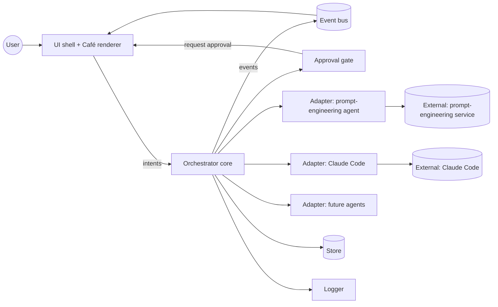
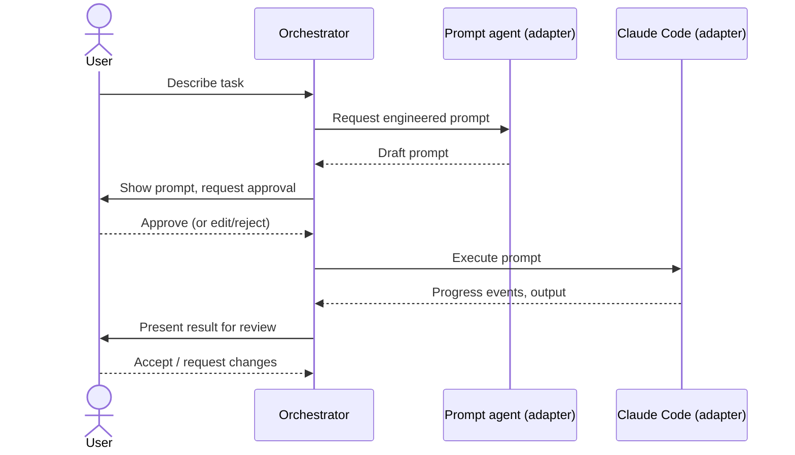

# architecture.md — Mushoku Guild Architecture

> **Status: PROPOSED.** Nothing here is implemented. This document describes the intended shape of the system and is the starting point for Discovery. It must evolve with the real implementation. Items marked **TBD** are undecided (see `docs/DECISIONS.md`, ADR-0003).

## 1. System overview

Mushoku Guild is a single-user desktop application that sits between the user and one or more AI agents. It replaces manual copy-paste handoff between a prompt-engineering agent and an executing coding agent, shows what each agent is doing as a game-like "guild café" scene, and gates execution on user approval.

Core idea: **a small, headless orchestration core** (tasks, handoffs, approvals, events) that is independent from **a thin presentation layer** (the café), connected by an event stream. This keeps the heavy "game" concerns out of the logic and lets the UI stay lightweight.

## 2. Major components

| Component | Responsibility | Status |
|-----------|---------------|--------|
| **UI shell** | Desktop window, windowing, input, notifications | TBD |
| **Café renderer** | Draws the scene: characters (agents), orders (tasks), status | TBD |
| **Orchestrator (core)** | Owns task lifecycle, routes work between agents, enforces approval gates | Proposed |
| **Agent adapters** | One per agent type; translate between the orchestrator's neutral interface and a concrete agent | Proposed |
| **Event bus** | In-process publish/subscribe of typed events; single source for the UI | Proposed |
| **Approval gate** | Pauses a task until the user approves/rejects an action | Proposed |
| **Store** | Persists tasks, prompts, events, settings (if persistence is confirmed) | TBD |
| **Config & secrets** | Settings, credential access via OS facilities | Proposed |
| **Logger** | Structured local logging | Proposed |

### Responsibilities in brief

- **Orchestrator** never talks to an agent directly; it uses an adapter.
- **Adapters** hide agent specifics (CLI, API, SDK). Adding an agent = adding an adapter.
- **UI/renderer** only reads events and sends user intents (create task, approve, cancel). It holds no business logic.
- **Approval gate** is part of the core, not the UI, so it cannot be bypassed by a UI bug.

## 3. Technology stack

| Concern | Choice |
|---------|--------|
| Language / runtime | TBD |
| Desktop shell | TBD |
| Rendering approach for café | TBD (constraint: no heavy game engine unless justified) |
| Persistence | TBD |
| Agent integration — Claude Code | TBD (candidates to evaluate: CLI subprocess, Agent SDK) |
| Agent integration — prompt engineering agent | TBD (ChatGPT/OpenAI API vs. other; feasibility open) |
| Packaging / installer | TBD |
| Test framework | TBD |

Selection criteria (from confirmed constraints): low idle CPU, low RAM, small install size, ease of spawning/streaming from subprocesses, Windows support, maintainability by a small team. Evaluation happens in `docs/plan.md` Phase 1.

## 4. Component interactions

All arrows are **proposed**.

## 5. External integrations

| Integration | Purpose | Route | Status |
|-------------|---------|-------|--------|
| Prompt-engineering agent (ChatGPT originally) | Turn a task description into an implementation prompt | Unknown — API availability for the consumer product is an open question | Not investigated |
| Claude Code | Execute the development task | Unknown — CLI subprocess or SDK to be spiked | Not investigated |
| Local filesystem / Git | Project working directory, diffs for review | Via Claude Code and/or direct | Not investigated |

No integration has been tested.

## 6. Agent orchestration model (proposed)

Initial model is a **linear pipeline with human gates**, mirroring the original workflow:

Generalisation to arbitrary agent graphs is **not** in scope until a second real use case exists (see `CLAUDE.md` §4).

## 7. Data flow

1. User intent enters via the UI → orchestrator creates a Task.
2. Orchestrator emits `TaskCreated`; renderer shows a new order.
3. Adapter calls produce a stream of events (`AgentStarted`, `AgentOutput`, `AgentFinished`, `AgentFailed`).
4. Approval gate emits `ApprovalRequested`; execution blocks until `ApprovalGranted/Denied`.
5. Events are appended to the store (if persistence is adopted) and fanned out to the UI.
6. The renderer maps events to scene state (e.g. character busy/idle, order progress).

Event and entity details: `docs/system-design.md`.

## 8. Deployment architecture

- Single local desktop process (plus child processes for agents). No server component, no cloud backend assumed (assumption A4 in `docs/context.md`).
- Target platform: Windows 11 at minimum; others TBD.
- Distribution/installer/updates: TBD.

## 9. Resource budget

Targets: **TBD**. Budgets will be set after measuring a baseline in the Discovery spike, then recorded here and in `docs/plan.md`. Design rules that apply regardless: event-driven (no polling loops), render throttling when unfocused, bounded in-memory logs, lazily loaded assets.

## 10. Open architectural questions

See `docs/context.md` §8. Notable: whether the orchestrator and renderer share a process, how agents are sandboxed/permissioned, and the persistence model.
