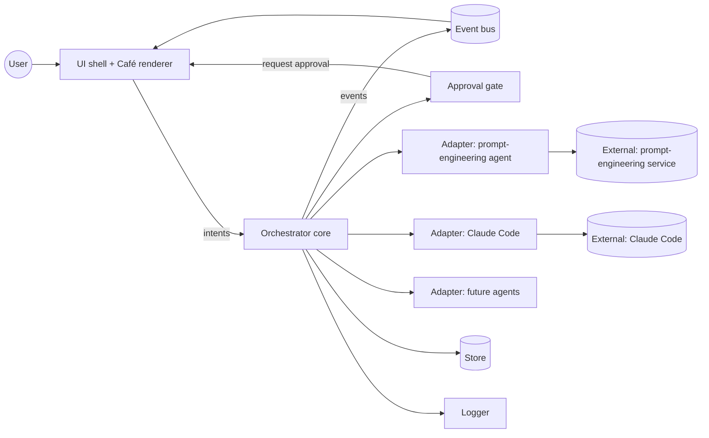
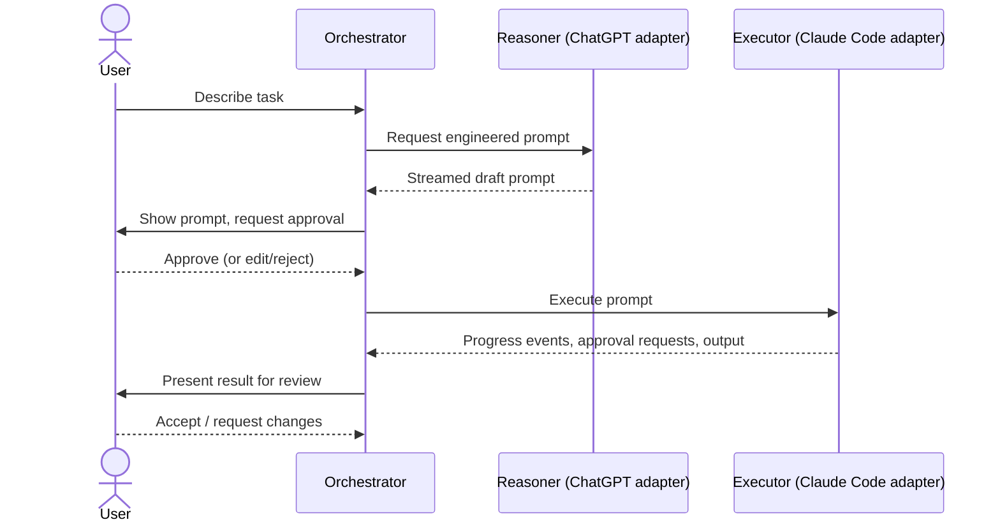
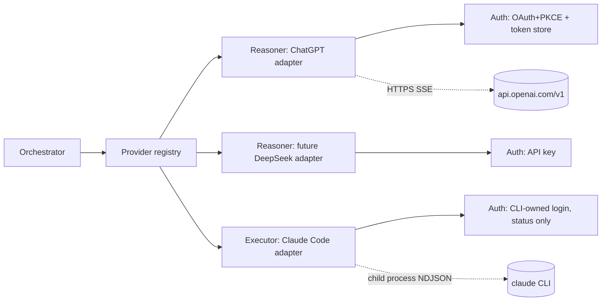

# architecture.md — Mushoku Guild Architecture

> **Status: PROPOSED.** Nothing here is implemented. This document describes the intended shape of the system and is the starting point for Discovery. It must evolve with the real implementation. Items marked **TBD** are undecided (see `docs/DECISIONS.md`, ADR-0003).

## 1. System overview

Mushoku Guild is a single-user desktop application that sits between the user and one or more AI agents. It replaces manual copy-paste handoff between a prompt-engineering agent and an executing coding agent, shows what each agent is doing as a game-like "guild café" scene, and gates execution on user approval.

Core idea: **a small, headless orchestration core** (tasks, handoffs, approvals, events) that is independent from **a thin presentation layer** (the café), connected by an event stream. This keeps the heavy "game" concerns out of the logic and lets the UI stay lightweight.

## 2. Major components

| Component | Responsibility | Status |
|-----------|---------------|--------|
| **UI shell** | Desktop window, windowing, input, notifications | TBD |
| **Café renderer** | Draws the scene: characters (agents), orders (tasks), status | TBD |
| **Orchestrator (core)** | Owns task lifecycle, routes work between agents, enforces approval gates | Proposed |
| **Agent adapters** | One per agent type; translate between the orchestrator's neutral interface and a concrete agent | Proposed |
| **Event bus** | In-process publish/subscribe of typed events; single source for the UI | Proposed |
| **Approval gate** | Pauses a task until the user approves/rejects an action | Proposed |
| **Store** | Persists tasks, prompts, events, settings (if persistence is confirmed) | TBD |
| **Config & secrets** | Settings, credential access via OS facilities | Proposed |
| **Logger** | Structured local logging | Proposed |

### Responsibilities in brief

- **Orchestrator** never talks to an agent directly; it uses an adapter.
- **Adapters** hide agent specifics (CLI, API, SDK). Adding an agent = adding an adapter.
- **UI/renderer** only reads events and sends user intents (create task, approve, cancel). It holds no business logic.
- **Approval gate** is part of the core, not the UI, so it cannot be bypassed by a UI bug.

## 3. Technology stack

| Concern | Choice |
|---------|--------|
| Language / runtime | TBD |
| Desktop shell | TBD |
| Rendering approach for café | TBD (constraint: no heavy game engine unless justified) |
| Persistence | TBD |
| Agent integration — Claude Code | Accepted (ADR-0006): unmodified `claude` CLI as child process, headless stream-json (ADR-0006). Agent SDK not used with subscription auth. |
| Agent integration — prompt engineering agent | Proposed (ADR-0007): ChatGPT via Sign in with ChatGPT plan usage; self-implemented client (ADR-0008). Spike succeeded for the user's account (`docs/context.md` §12); Go eligibility not confirmed by OpenAI. |
| Provider abstraction | Proposed (ADR-0009), see §6a |
| Packaging / installer | TBD |
| Test framework | TBD |

Selection criteria (from confirmed constraints): low idle CPU, low RAM, small install size, ease of spawning/streaming from subprocesses, Windows support, maintainability by a small team. Evaluation happens in `docs/plan.md` Phase 1.

## 4. Component interactions



All arrows are **proposed**.

## 5. External integrations

Status of each (facts and sources in `docs/context.md` §11):

| Integration | Purpose | Route | Status |
|-------------|---------|-------|--------|
| ChatGPT (prompt engineering) | Turn a task description into an implementation prompt | Sign in with ChatGPT "plan usage": OAuth+PKCE to `auth.openai.com`, then streaming Responses API at `api.openai.com/v1` | Documented by OpenAI; flow **verified in a spike** (auth, models, streamed inference; refresh/limits untested); **Go eligibility observed, not confirmed by OpenAI**; DevKit licence is noncommercial |
| Claude Code (execution) | Execute the development task | Spawn the user's unmodified `claude -p --output-format stream-json` under their own login (ADR-0006) | **Verified in a spike** (`docs/context.md` §13): discovery, launch, stream-json events, permission denial and approval via an MCP approver, cancellation, login retention. Uses behaviour not covered by official docs (observed on CLI 2.1.319); policy question open |
| Local filesystem / Git | Project working directory, diffs for review | Via Claude Code and/or direct | Not investigated |
| Future providers (e.g. DeepSeek) | Additional Reasoners or Executors | Adapter per provider | Not investigated |

## 6. Agent orchestration model (proposed)

Initial model is a **linear pipeline with human gates**, mirroring the original workflow:



Generalisation to arbitrary agent graphs is **not** in scope until a second real use case exists (see `CLAUDE.md` §4).

## 6a. Provider abstraction (PROPOSED — ADR-0009, not accepted)

Design goals: ChatGPT generates prompts; Claude Code executes them; a new provider (e.g. DeepSeek) is added by writing one adapter and registering it, with no change to the orchestrator, event model or UI. Keep it as small as the two real adapters require (`CLAUDE.md` §4).

Three separate concerns, because the two real providers differ on each:

1. **Auth** (`AuthProvider`): how the user becomes signed in. ChatGPT: app-run OAuth+PKCE with a rotating refresh token that the app must store and refresh. Claude Code: the CLI owns the login; the app only reads status and never touches credentials. A DeepSeek-style provider: an API key from the OS credential store.
2. **Role**: what the provider does for the orchestrator.
   - `Reasoner`: `generate(request) -> Stream<TextEvent>`; stateless; the caller sends the full history and instructions; one streamed text response (ChatGPT, later DeepSeek or others).
   - `Executor`: `start(job) -> Run`; long-running, works inside a project directory, emits progress, may ask for approvals, can be cancelled, ends with an outcome (Claude Code).
3. **Capabilities** (`ProviderInfo`): declared, not assumed — roles supported, auth kind, streaming, model discovery, whether sampling parameters or token limits are accepted, whether it can request approvals. The UI and orchestrator read these instead of hard-coding provider names.

A **registry** maps provider IDs to adapters; configuration chooses which provider fills which role. All adapters map their native errors into one shared taxonomy (`not_signed_in`, `not_eligible`, `usage_limit`, `transient`, `unsupported`, `cancelled`, `failed`) so retry policy and UI messages are provider-independent. Details: `docs/system-design.md` §2.2.



Recommended integration summary: ChatGPT via a self-implemented, small OAuth+PKCE and Responses-SSE client (subject to the licence/terms review, ADR-0008) behind the Reasoner role; Claude Code via a child process in headless stream-json mode behind the Executor role (ADR-0006).

## 6b. Claude Code executor: launch, approval and cancel model (PROPOSED design; behaviour verified in a spike, `docs/context.md` §13)

```mermaid
sequenceDiagram
    participant App as Mushoku Guild (Executor adapter)
    participant CLI as claude.exe (-p, stream-json)
    participant Ap as Approver MCP server (child of CLI)
    App->>App: discover claude.exe, check version, signature, auth status
    App->>CLI: spawn (cwd=project, scrubbed env, prompt on stdin)
    CLI-->>App: system/init, assistant, tool_use ... (NDJSON on stdout)
    CLI->>Ap: tools/call approve {tool_name, input, tool_use_id}
    Ap->>App: forward request (loopback socket / named pipe)
    App->>App: user approves or denies in the UI
    App-->>Ap: decision
    Ap-->>CLI: {"behavior":"allow"|"deny", ...}
    CLI-->>App: user tool_result, assistant text, result
    Note over App,CLI: Cancel: stream-json interrupt, close stdin, wait; else taskkill /T /F on the tree
```

- **Discovery:** user override → `PATH` search for `claude.exe` → `%USERPROFILE%\.local\bin\claude.exe`; validate with `--version`, Authenticode signature (Anthropic, PBC) and `claude auth status`. Shims and `System32\bash.exe` (WSL) are never used.
- **Launch:** `spawn(exe, args, {cwd, env: scrubbed, windowsHide, shell:false})`, prompt on stdin, always `--strict-mcp-config` plus only the app's own MCP config, explicit `--tools`, `--max-turns`, no `--dangerously-skip-permissions`.
- **Approval (experimental, CLI 2.1.319-specific):** default is deny; per-action approval through `--permission-prompt-tool` pointing at a small approver MCP server that bridges to the app (extra child process per run). Pre-approved tool lists (`--allowedTools`) remain an option for low-risk steps.
- **Cancel (graceful interrupt is experimental, CLI 2.1.319-specific):** graceful `interrupt` control request over stream-json input, then `taskkill /PID … /T /F` on the tree as fallback; treat a stream without `result` as aborted.
- **Outcome:** decided from the `result` event (`subtype`, `is_error`, `terminal_reason`, `permission_denials`), not from the exit code.
- **Limits:** relies on undocumented-but-observed behaviour in CLI 2.1.319 (interrupt message, approver contract, event fields). Not decided: whether to use a long-lived stream-json process per project or one process per task; this needs idle-cost measurement.

## 7. Data flow

1. User intent enters via the UI → orchestrator creates a Task.
2. Orchestrator emits `TaskCreated`; renderer shows a new order.
3. Adapter calls produce a stream of events (`AgentStarted`, `AgentOutput`, `AgentFinished`, `AgentFailed`).
4. Approval gate emits `ApprovalRequested`; execution blocks until `ApprovalGranted/Denied`.
5. Events are appended to the store (if persistence is adopted) and fanned out to the UI.
6. The renderer maps events to scene state (e.g. character busy/idle, order progress).

Event and entity details: `docs/system-design.md`.

## 8. Deployment architecture

- Single local desktop process (plus child processes for agents). No server component, no cloud backend assumed (assumption A4 in `docs/context.md`).
- Target platform: Windows 11 at minimum; others TBD.
- Distribution/installer/updates: TBD.

## 9. Resource budget

Targets: **TBD**. Budgets will be set after measuring a baseline in the Discovery spike, then recorded here and in `docs/plan.md`. Design rules that apply regardless: event-driven (no polling loops), render throttling when unfocused, bounded in-memory logs, lazily loaded assets.

## 10. Open architectural questions

See `docs/context.md` §8. Notable: whether the orchestrator and renderer share a process, how agents are sandboxed/permissioned, and the persistence model.
