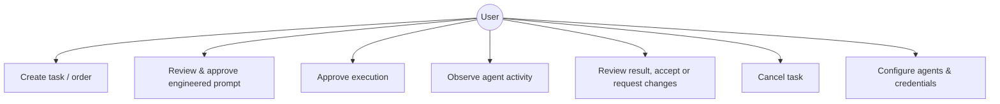
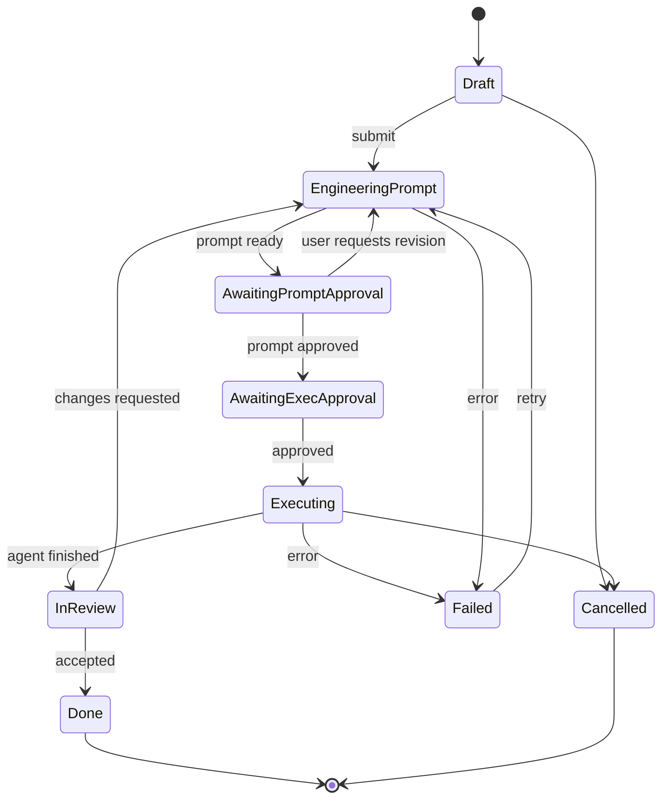

# system-design.md — Mushoku Guild System Design

> **Status: PROPOSED design** (the technology stack, MVP scope and provisional budgets are accepted: ADR-0010, ADR-0011, ADR-0012). Nothing described here is implemented. Sections labelled *Confirmed* derive from the user's stated requirements (`docs/context.md`); everything else is a proposal for Discovery to validate. Interfaces are written in language-neutral pseudo-notation; the stack (Rust core, TypeScript UI) is decided by ADR-0010.

---

# Part 1 — High-Level Design

## 1.1 Problem statement

Developers who use one AI assistant to engineer prompts and another to execute them must manually copy prompts between tools and manually track and review the outcome. This is tedious, error-prone, and gives no unified view of what each agent is doing. *(Confirmed)*

## 1.2 Product objectives

- Automate prompt creation → handoff → execution → review presentation. *(Confirmed)*
- Present agents and tasks as characters and quests/orders in a cozy café/guild scene. *(Direction, not all confirmed)*
- Keep the user in control through approvals. *(Confirmed)*
- Remain lightweight. *(Confirmed)*
- Support additional agents later. *(Confirmed)*

## 1.3 Functional requirements

Confirmed (F-C) and proposed (F-P):

| ID | Requirement | Basis |
|----|-------------|-------|
| F-C1 | User can describe a development task. | Confirmed (workflow step 1) |
| F-C2 | System obtains an engineered implementation prompt from a prompt-engineering agent. | Confirmed (step 2); intended route is ChatGPT via Sign in with ChatGPT (proposed ADR-0007; works in a spike, Go eligibility not confirmed by OpenAI) |
| F-C3 | System hands the prompt to Claude Code without manual copy/paste. | Confirmed (steps 3–4) |
| F-C4 | Claude Code executes the task for real. | Confirmed (step 5, "real integrations") |
| F-C5 | User can see what each agent is doing and task status/progress. | Confirmed |
| F-C6 | User can review results. | Confirmed (step 6) |
| F-C7 | User approves/controls task execution. | Confirmed |
| F-C8 | New agent types can be added. | Confirmed (modularity) |
| F-P1 | Agents shown as characters; tasks as quests/orders in a café scene. | Proposed (direction) |
| F-P2 | Task history is persisted and browsable. | Proposed |
| F-P3 | User can edit a prompt before handoff. | Proposed |
| F-P4 | User can cancel a running task. | Proposed |
| F-P5 | User can request changes after review, looping back. | Proposed |

## 1.4 Non-functional requirements

| ID | Requirement | Status |
|----|-------------|--------|
| N-C1 | Minimal CPU and RAM; no heavy game engine without justification. | Confirmed |
| N-C2 | Usability is not sacrificed for presentation. | Confirmed |
| N-C3 | Modular architecture. | Confirmed |
| N-P1 | Idle CPU near zero; numeric budgets TBD after baseline measurement. | Proposed |
| N-P2 | Responsive UI: agent work never blocks the UI thread. | Proposed |
| N-P3 | Failures are surfaced clearly, never silent. | Proposed |
| N-P4 | Local-first; secrets never leave the machine except to the configured provider. | Proposed |
| N-P5 | Accessibility basics (keyboard operation, text alternative to visual state). | Proposed |

## 1.5 System boundaries

**Inside:** task management, prompt handoff, approval gating, agent adapters, event display (café), local persistence/config.

**Outside:** the AI agents themselves (ChatGPT, Claude Code), the user's code repositories, the LLM providers, OS credential store.

## 1.6 Actors and use cases

Actors: **User** (primary); **Prompt agent**; **Execution agent (Claude Code)**; future agents.



## 1.7 Major components

See `docs/architecture.md` §2. Summary: UI shell, café renderer, orchestrator, agent adapters, event bus, approval gate, store, config/secrets, logger.

## 1.8 Integration points

| Point | Direction | Notes |
|-------|-----------|-------|
| Reasoner adapter (ChatGPT) ↔ `auth.openai.com` / `api.openai.com/v1` | Outbound HTTPS, SSE | OAuth+PKCE and Responses API; documented, untested (`docs/context.md` §11.1) |
| Executor adapter ↔ `claude` CLI | Child process, NDJSON stream | Headless stream-json; trivial call verified, approvals/cancel untested (§11.2) |
| Config ↔ OS credential store | Local | Proposed |
| Project working directory | Local | Where Claude Code runs |

## 1.9 Security and privacy considerations (proposed)

- Agents can run code and edit files: **execution requires explicit user approval by default**; approvals are enforced in the orchestrator, not just the UI.
- Show the user exactly what will be sent/run before approval.
- Credentials stored via OS facilities or environment; never in repo, logs, or events.
- Prompts and outputs may contain sensitive code: stored locally only; log redaction for secrets.
- Agent output is untrusted: render as text, never interpret as markup or commands.
- Restrict the agent's working directory to the user-selected project path.
- Prompt-injection risk: content returned by one agent and fed to another is data; the approval gate is the mitigation.

## 1.10 Scalability considerations

Single user, local — "scale" means *number of concurrent agents/tasks*, not users. Design for a handful of concurrent tasks; bounded event history; render cost independent of history length. Multi-user/cloud is out of scope (assumption A4).

## 1.11 MVP cut

The subset of these requirements planned for the first release is defined in `docs/context.md` §14 (M1–M8, accepted ADR-0011); everything else, including multiple providers, concurrent agents and diff tooling, is future work.

---

# Part 2 — Low-Level Design (all proposed)

## 2.1 Module responsibilities

| Module | Responsibility | Depends on |
|--------|---------------|------------|
| `core/orchestrator` | Task state machine, routing, approvals | `agents`, `events`, `store` |
| `core/events` | Typed event definitions, bus | — |
| `core/approval` | Approval requests/decisions, policy | `events` |
| `agents/<name>` | Adapter implementing the Agent interface | external agent |
| `store` | Persistence of tasks/events/settings | — |
| `config` | Settings, secrets access | OS |
| `ui/shell` | Window, input, intents | `core` (via events/intents) |
| `ui/cafe` | Scene state derived from events | `events` |
| `log` | Structured logging | — |

Dependency rule: `ui` → `core`; `core` never imports `ui`; adapters never import `ui`.

## 2.2 Proposed interfaces (provider abstraction — PROPOSED, ADR-0009)

Pseudo-notation, not a language choice. Rationale and diagram: `docs/architecture.md` §6a.

```
ProviderInfo {
  id, displayName
  roles: ("reasoner" | "executor")[]
  auth: "oauth-app" | "cli-owned" | "api-key"
  features: { streaming, modelDiscovery, samplingParams, tokenLimit, approvalRequests }
}

interface AuthProvider {
  status(): AuthStatus             // signed_out | signed_in(account) | needs_reauth | unavailable
  signIn(): AuthFlow               // may open a browser / ask the user to run a CLI command
  signOut()
  // Reasoner-side providers expose credentials only to their own adapter, never to the core
}

interface Reasoner {                // e.g. ChatGPT, later DeepSeek
  listModels(): Model[]
  generate(req: { model, instructions, input: Message[] }): Stream<ReasonerEvent>
    // ReasonerEvent: TextDelta | Completed | Failed(ProviderError)
    // Caller owns conversation history; adapters must not depend on server-side state.
}

interface Executor {                // e.g. Claude Code
  start(job: { prompt, projectPath, policy: ApprovalPolicy }): Run
}
interface Run {
  events: Stream<RunEvent>          // Started | Output | ToolActivity | ApprovalRequest | Finished(outcome) | Failed
  respond(approvalId, decision)     // only if features.approvalRequests
  cancel()
}

interface Orchestrator {
  createTask(description, projectPath): TaskId
  approve(approvalId) / reject(approvalId, reason?)
  cancel(taskId)
  requestChanges(taskId, feedback)
  subscribe(handler): Unsubscribe
}

ProviderError { kind: not_signed_in | not_eligible | usage_limit | transient
                       | unsupported | cancelled | failed,
                providerCode?, message, retryable, retryAfter? }
```

Adapter notes (from `docs/context.md` §11; behaviour marked unverified has not been tested):

- **ChatGPT Reasoner:** sends `store:false, stream:true`; maps `instructions`; omits unsupported fields; success only on `response.completed`; maps `subscription_sharing_usage_limit_exceeded` → `usage_limit`, `_user_not_eligible` → `not_eligible`, `_unsupported_capability` → `unsupported`, refresh failures → `not_signed_in`, 503s → `transient`. Model list is discovered at run time, never hard-coded.
- **Claude Code Executor:** spawns `claude -p --output-format stream-json --verbose` in the project directory with the prompt on stdin; maps result `subtype` and `is_error` to `Finished`/`Failed` (not the exit code alone); surfaces `permission_denied` events and `permission_denials`; maps `rate_limit_event` and `api_retry` auth/rate categories to `usage_limit` / `not_signed_in`. Per-action approval uses `--permission-prompt-tool` with a small approver MCP server; its contract and the graceful interrupt message were observed in a spike on CLI 2.1.319 (not officially documented). Full detail: §2.15 and `docs/context.md` §13.
- **Future providers** implement `Reasoner` and/or `Executor` plus an `AuthProvider`; OpenAI-compatible chat APIs with an API key are expected to be the cheapest to add. Not investigated.

## 2.3 Data models

```
Task        { id, title, description, projectPath, status, createdAt, updatedAt,
              currentStepId?, prompts: PromptVersion[], result?: Result }
Step        { id, taskId, agentId, kind, status, startedAt, finishedAt, error? }
PromptVersion { id, taskId, version, text, author: "agent"|"user", approved: bool }
Approval    { id, taskId, stepId, kind, summary, status: pending|approved|rejected, decidedAt? }
Event       { id, ts, taskId?, type, payload }
AgentConfig { id, kind, enabled, settings }       // secrets by reference, not value
Result      { summary, changedFiles?, rawOutputRef?, reviewStatus }
```

## 2.4 Database design

Decided (ADR-0010): SQLite accessed from the Rust core via rusqlite (ADR-0010, accepted). The tables, retention and migration approach in §2.16 are proposed design.

## 2.5 Task lifecycle



(Whether prompt approval and execution approval are separate gates is an open question.)

## 2.6 Agent lifecycle

`Idle → Starting → Running → (WaitingForUser) → Finished | Failed | Cancelled`. One `AgentRun` per Step. Adapter owns process/connection cleanup; orchestrator guarantees `cancel()` on app exit.

## 2.7 Prompt lifecycle

`TaskDescription → (agent) DraftPrompt v1 → user edit/approve → ApprovedPrompt → sent to executor`. Each revision is a stored `PromptVersion`; the exact text sent to the executor is recorded for auditability. Changes requested after review produce a new prompt version linked to the same task.

## 2.8 Event handling

Typed events on an in-process bus: `TaskCreated`, `TaskStatusChanged`, `PromptDrafted`, `ApprovalRequested`, `ApprovalResolved`, `AgentStarted`, `AgentOutput`, `AgentFinished`, `AgentFailed`, `TaskCompleted`. Rules: events are immutable; handlers must not block; UI is a pure projection of events; `AgentOutput` volume is throttled/batched before rendering and bounded in memory.

## 2.9 Error handling and retries

- Classify errors: transient (network, rate limit), agent failure, user-cancel, internal.
- Retry transient errors with bounded exponential backoff (e.g. a small fixed max); never auto-retry anything that has side effects on the user's code without approval.
- Failures move the Step/Task to `Failed` with a human-readable reason and a user-visible Retry action.
- Adapter crashes/timeouts are detected and surfaced; child processes are always reaped.

## 2.10 Configuration management

Layered: defaults → user config file → environment overrides. Secrets referenced by name and resolved from the OS credential store or environment at use time. Config schema is validated on load with clear errors. Format and location: TBD.

## 2.11 Logging and observability

Structured local logs with levels, rotation and size cap; secrets redacted. Per-task correlation id on every log line and event. A user-visible activity view is the observability feature that matters most (confirmed need for visibility). Telemetry: none assumed; any telemetry would require an explicit decision.

## 2.12 Testing strategy (proposed)

Unit tests for the state machine and approval gate; contract tests for adapters using a fake agent; at least one manual or automated end-to-end test against the real Claude Code before any integration is marked verified; resource measurements recorded in `docs/plan.md`.

## 2.13 Provider authentication and token lifecycle (proposed)

**ChatGPT (app-run OAuth):**

1. On first launch generate and persist a random `urn:uuid:` host ID (opaque, not an identifier of the user).
2. Start a loopback listener on `127.0.0.1:<port>`, open the system browser to the authorize URL with fresh `state`, `nonce`, PKCE S256 challenge, the plan-usage scope set and `resource=https://api.openai.com/v1`. First time: `client_id=dynamic_agent_client`, `agent_name_hint=Mushoku Guild`, `ext_agent_host_id`.
3. Validate `state`, exchange the code, **save the issued client ID**, verify the ID token (signature via JWKS, issuer, audience, expiry, nonce), check the granted scopes include `chatgpt.tokens.use.direct`; otherwise mark plan usage disabled.
4. Persist credentials (access, refresh, ID token, expiry, scopes, client ID, host ID) in a protected per-user file, written atomically with owner-only permissions; never log them. Storage mechanism (file vs OS credential store) is TBD.
5. Refresh shortly before the one-hour access-token expiry, serialised by a single in-process lock; replace access token, expiry, scopes and the rotating refresh token together. On a terminal refresh error, clear tokens and prompt the user to sign in again with the saved client ID. Do not clear credentials on transient network failures.
6. Sign-out: revoke the refresh token at the discovered revocation endpoint (retry with backoff; tell the user if revocation was not confirmed), then clear local tokens.

Steps 1–3 (registration, authorization, exchange, ID-token and scope checks) and a streamed inference were exercised in a spike (`docs/context.md` §12). Steps 4–6 (persistence, refresh, revocation) remain **untested**. Go eligibility is observed, not confirmed by OpenAI.

**Claude Code (CLI-owned):** the app never handles credentials. It runs `claude auth status` (exit 0 if logged in, 1 if not) to show state, warns if `ANTHROPIC_API_KEY` is set (the CLI would then bill that key instead of the subscription), and tells the user to run `claude auth login` themselves when signed out.

**API-key providers (future):** key stored via the OS credential facility; never in config files or logs.

## 2.14 Plan-usage and limit handling (proposed)

- Surface "Using ChatGPT plan" and a "Manage usage" link to `https://chatgpt.com/settings/usage` as required by OpenAI's UI guidelines.
- On `usage_limit` from any provider: pause new work for that provider, keep the task resumable, show the provider's own message; do not infer a reset time from the error alone and do not silently switch provider or billing path.
- Claude Code's `rate_limit_event` data (five-hour and seven-day utilisation) can feed a status display; the field set is observed (`docs/context.md` §11.2) but not documented, so treat it as best-effort.

## 2.15 Claude Code executor adapter details (proposed; behaviour observed in a spike, `docs/context.md` §13)

**Startup checks (before enabling the Executor):** executable found and version parses; version >= a pinned minimum (TBD, tested: 2.1.319); Authenticode status `Valid` with signer Anthropic, PBC (warn, do not hard-fail, if it differs); `claude auth status` reports `loggedIn`; warn if `ANTHROPIC_API_KEY`/`ANTHROPIC_AUTH_TOKEN` is present (it would override the subscription); show the login expiry date.

**Run lifecycle:** `Idle → Starting (spawn) → Running (init received) → [WaitingForApproval] → Finished | Failed | Cancelled`. One child process per `Run` (per-project long-lived process: undecided). On app exit, cancel all runs (process tree) so nothing is orphaned.

**Event mapping (observed schema; EXPERIMENTAL and version-specific, parse defensively):**

| CLI event | `RunEvent` |
|-----------|-----------|
| `system/init` | `Started {sessionId, model, tools, permissionMode}` |
| `assistant` text / `stream_event` text deltas | `Output {text}` |
| `assistant` `tool_use` | `ToolActivity {name, input summary, toolUseId}` |
| `user` `tool_result` | `ToolActivity` completion (ok/error) |
| `system/permission_denied` | `ToolDenied {tool, reason}` (not a failure) |
| approver `tools/call` | `ApprovalRequest {approvalId, tool, input, toolUseId}` |
| `rate_limit_event` | usage status update |
| `result` | `Finished {outcome}` or `Failed` per rules below |
| unknown event | logged and ignored |

**Outcome rules:** `result.subtype == success && !is_error` → Finished (even if `permission_denials` is non-empty; surface them to the user); `is_error` or `subtype != success` → Failed or Cancelled depending on `terminal_reason` and whether the user requested cancel; no `result` before the process ended → Failed("aborted/crashed"). Exit code is recorded for diagnostics only.

**Approval bridge (EXPERIMENTAL, CLI 2.1.319-specific; not in the official docs):** the approver MCP server receives `{tool_name, input, tool_use_id}` and must answer with a text content block holding JSON `{"behavior":"allow","updatedInput":…}` or `{"behavior":"deny","message":…}`. It relays to the app and blocks until the user decides; policy for timeout (default deny after N seconds) and for app/approver crashes (deny) is proposed, untested.

**Cancel (graceful interrupt is EXPERIMENTAL and CLI 2.1.319-specific; the `taskkill` fallback is plain Windows behaviour):** write `{"type":"control_request","request_id":…,"request":{"subtype":"interrupt"}}` to stdin (requires `--input-format stream-json`, so the prompt is also sent as a stream-json user message), wait for `result`, close stdin, wait up to a short grace period, then `taskkill /PID <pid> /T /F`. Never rely on `child.kill()` alone on Windows.

**Parsing:** line-buffered NDJSON, tolerate partial chunks and unknown fields, bound stored events per run, redact nothing automatically (assistant output and tool inputs can contain secrets from the user's project; treat them as sensitive in logs).

**Windows notes:** `windowsHide`, `shell:false`, scrubbed environment, never `System32\bash.exe`, Job Object fallback (untested).

## 2.16 Persistence design (design PROPOSED; engine accepted in ADR-0010)

SQLite accessed only from the Rust core (rusqlite, `bundled`); the frontend reaches data only through typed core commands. Journal mode WAL, foreign keys on, a schema version table with forward-only migrations applied at startup. Writes are batched (events are flushed on a short timer or when a batch fills) so an idle app performs no writes.

Proposed tables (names and columns are a starting point, not final):

| Table | Purpose and key columns |
|-------|------------------------|
| `schema_version` | `version`, `applied_at` |
| `projects` | `id`, `path`, `display_name`, `last_used_at` |
| `tasks` | `id`, `project_id`, `title`, `description`, `status`, `policy`, `created_at`, `updated_at`, `result_summary`, `review_status` |
| `prompt_versions` | `id`, `task_id`, `version`, `text`, `author` (`agent`/`user`), `approved`, `created_at` |
| `steps` | `id`, `task_id`, `role` (`reasoner`/`executor`), `provider_id`, `model`, `status`, `started_at`, `finished_at`, `error_kind`, `error_message`, `cli_session_id?` |
| `approvals` | `id`, `task_id`, `step_id`, `kind`, `tool_name`, `summary`, `decision`, `decided_at`, `decided_by` |
| `events` | `id`, `task_id`, `ts`, `type`, `payload_json` (bounded; see retention) |
| `accounts` | `id`, `provider_id`, `display_label` (masked), `issued_client_id`, `host_id`, `status` — **no tokens**; secrets live in the OS credential store |
| `settings` | key/value (policy defaults, lite mode, selected models, project paths) |

Retention: configurable; default keep full task/prompt/approval rows indefinitely, trim `events` payloads older than a limit (for example 90 days or the newest N events per task), and offer "delete history". Prompts and outputs are sensitive: local only, never logged verbatim by default. Encryption at rest is not an MVP requirement (open item in `docs/context.md` §15.5).

## 2.17 Core ↔ UI contract and scene projection (PROPOSED)

- **Commands (UI → core)**, each validated in Rust: `create_task`, `approve_prompt`, `edit_prompt`, `request_prompt_revision`, `start_run(policy)`, `decide_approval(id, allow|deny)`, `cancel_task`, `accept_result`, `request_changes`, `list_history`, `get_task`, `sign_in(provider)`, `sign_out(provider)`, `get_provider_status`, `get_settings` / `set_setting`. No generic shell, filesystem or SQL command exists.
- **Streams (core → UI)**: a single ordered Tauri Channel carrying typed `CoreEvent`s (`TaskStatusChanged`, `PromptDelta`, `RunOutput`, `ToolActivity`, `ApprovalRequested`, `ProviderStatusChanged`, `UsageUpdated`, `Error`). Token/tool deltas are coalesced in the core (for example at most one batch per 33 ms) because Tauri events are not designed for high throughput and ordering [doc].
- **Implemented in Phase 2 (verified, `docs/architecture.md` §13):** the Rust core publishes `window-minimized` (WebView2 does not report minimisation to the page); the scene controller has three regimes — stopped (nothing scheduled), ambient (a timer changes the idle pose about 3 times per second and draws only then; no `requestAnimationFrame` loop) and active (Pixi's shared ticker capped at 30 fps, drawing only on change); Pixi's internal system ticker stays stopped. The proposed reducer below is **not implemented yet**; today only the measurement fixtures drive the scene.
- **Scene projection**: the UI keeps a small reducer `CoreEvent → SceneState` (per character: `idle | thinking | waiting | working | blocked | done`, plus order-ticket state). The PixiJS controller subscribes to `SceneState` changes only, runs the ticker only while some animation is active, and stops it when the window is hidden, minimised or unfocused. The plain-text activity panel renders from the same events, so it is the accessible equivalent of the scene.
- **Back-pressure and bounds**: the UI retains a bounded window of recent events per task; full history is fetched from SQLite on demand.
- **Error surface**: every `ProviderError` kind (`docs/system-design.md` §2.2) maps to one user-facing message and, where useful, a single recovery action (sign in again, open "Manage usage", re-run preflight).
